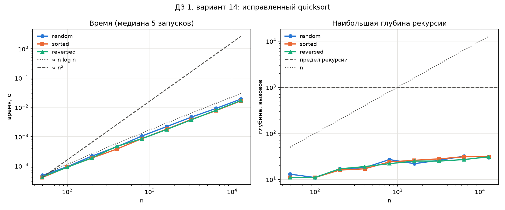

# Отчёт по ДЗ 1. Верификация ИИ-сгенерированной сортировки

**Вариант:** N = `14`
**Seed:** `30 + 14 = 44`
**Окружение:** Python `3.11`, CPU `12th Gen Intel(R) Core(TM) i5-12400F — 6 ядер.`

Файлы: `dz01-ai-code.py` — проверяемый код (неизменённая копия `Cases/attachments/dz01-ai-code.py`), `dz01-ai-code-fixed.py` — исправленная копия (раздел 8), `case-01-ai-verification-sort.py` — верификация. Запуск: `python COMPLETED-CASE-01/case-01-ai-verification-sort.py --variant 14`, для исправленной копии — с флагом `--fixed`. Код отформатирован `black` и проверен `pylint`.

## 1. Проверяемый код и заявленные свойства

```python
def quicksort(data: list[int]) -> list[int]:
    if len(data) <= 1:
        return list(data)
    pivot = data[0]
    smaller = [x for x in data if x < pivot]
    larger = [x for x in data if x > pivot]
    return quicksort(smaller) + [pivot] + quicksort(larger)
```

Опорный — первый элемент. Вход делится на элементы меньше и больше опорного, части сортируются рекурсивно и склеиваются вокруг опорного. В файле это строки 26–31.

| № | Заявлено в docstring | Чем проверяется |
| --- | --- | --- |
| 1 | корректность: «Sort a list of integers» | шаги 1–3 |
| 2 | «Time complexity: O(n log n)» — без оговорки «в среднем», то есть для любого входа | шаг 4, худший случай |
| 3 | «space complexity: O(log n) for the recursion stack» | шаг 4, глубина рекурсии |
| 4 | «The input list is not modified» | шаги 2–3 |
| 5 | примеры `[3, 1, 2]` → `[1, 2, 3]` и `[]` → `[]` | `doctest`: 2 из 2 |

Примеры из docstring проходят, но это короткие входы без повторов, и корректность они не доказывают.

## 2. Шаг 1 — инварианты

```python
def is_sorted(a: list[int]) -> bool:
    return all(a[i] <= a[i + 1] for i in range(len(a) - 1))


def same_multiset(a: list[int], b: list[int]) -> bool:
    return Counter(a) == Counter(b)


def check_invariants(original: list[int], result: list[int]) -> list[str]:
    violations = []
    if not is_sorted(result):
        i = next(i for i in range(len(result) - 1) if result[i] > result[i + 1])
        violations.append(f"инвариант 1 (упорядоченность): сбой на позиции {i}")
    if not same_multiset(original, result):
        lost = (Counter(original) - Counter(result)).total()
        extra = (Counter(result) - Counter(original)).total()
        violations.append(
            f"инвариант 2 (перестановка): потеряно {lost}, лишних {extra}"
        )
    return violations
```

- **Инвариант 1** — соседи идут по неубыванию (`<=`, равные допустимы). **Инвариант 2** — счётчики `Counter` входа и выхода совпадают, то есть совпадают и элементы, и их кратности. Оба проверяются за Θ(n).
- `check_invariants` не прерывает программу, а возвращает список нарушений: проверяемый код может их давать, и нужно увидеть все.

**Проверка самих инвариантов.** Её делает `self_check`, на `expect()` вместо `assert`, чтобы работать и под `python -O`.
- 5 заведомо неверных выходов нарушают ровно свои инварианты: неотсортированный `[3, 1, 2]` — только инвариант 1; `[3, 1, 3]` → `[1, 3]` — только 2; `[2, 1]` → `[3, 0]` — оба.
- На 100 случайных массивах эталон `sorted(a)` проходит, а выход `sorted(set(a))` ловит только инвариант 2 — и только если в массиве есть дубликаты.
- Подмена помощников на неверные (`<` вместо `<=`, `set` или длина вместо `Counter`) — все 5 подмен `self_check` ловит.

## 3. Шаг 2 — репрезентативные тесты

```python
def representative_cases(rng: random.Random) -> list[tuple[str, list[int]]]:
    def distinct(n: int) -> list[int]:
        return rng.sample(range(-(10**6), 10**6), n)

    cases = [
        ("граничный: пустой", []),
        ("граничный: один элемент", [7]),
        ("граничный: два по возрастанию", [1, 2]),
        ("граничный: два по убыванию", [2, 1]),
        ("граничный: два равных", [5, 5]),
    ]
    for n in (10, LARGE_N):
        cases += [
            ("вырожденный: все равны", [3] * n),
            ("вырожденный: отсортированный", sorted(distinct(n))),
            ("вырожденный: обратный", sorted(distinct(n), reverse=True)),
        ]
    cases.append(("типовой: случайный без дубликатов", distinct(1000)))
    for n, span in ((10, 5), (100, 50), (1000, 1000)):
        data = [rng.randint(-span, span) for _ in range(n)]
        cases.append(("типовой: случайный с дубликатами", data))
    return cases
```

- **Каждый класс проверяет одно свойство входа.** Упорядоченные входы составлены из различных чисел, случайный вход есть и без дубликатов, и с ними. Случайные данные берутся из `rng` с seed = 44.
- **Вырожденные классы — в двух размерах:** n = 10 и n = `LARGE_N` = 2000. Это вдвое больше предела рекурсии Python, тогда как заявленному стеку O(log n) хватило бы ~11 вызовов.
- `run_representative_tests` проверяет оба инварианта, неизменность входа и аварийное завершение: исключение перехватывается и записывается как результат.

| Класс входа | n | Результат |
| --- | --- | --- |
| граничные: пустой, один, два по возрастанию / убыванию | 0–2 | OK |
| граничный: два равных | 2 | `[5, 5]` → `[5]` (инвариант 2) |
| вырожденный: все равны | 10 / 2000 | выход `[3]`: потеряно 9 / 1999 |
| вырожденные: отсортированный, обратный | 10 | OK |
| вырожденные: отсортированный, обратный | 2000 | **`RecursionError`** |
| типовой: случайный без дубликатов | 1000 | OK |
| типовой: случайный с дубликатами | 10 / 100 / 1000 | потеряно 2 / 35 / 223 |

Найдено два независимых нарушения:
1. **Потеря элементов** — на всех 6 входах с повторами, и только на них. Выход при этом упорядочен, так что проверка одной лишь упорядоченности признала бы код верным.
2. **`RecursionError`** — только на отсортированном и обратном входах из 2000 элементов. При n = 10 и на случайном входе без дубликатов всё проходит.

Вход не изменился ни разу.

## 4. Шаг 3 — сравнение с эталоном `sorted()`

```python
def shrink(data: list[int]) -> list[int]:
    shrunk = True
    while shrunk:
        shrunk = False
        for i in range(len(data)):
            candidate = data[:i] + data[i + 1 :]
            if call_sort(candidate)[0] != sorted(candidate):
                data, shrunk = candidate, True
                break
    return data
```

- **Входы.** 300 случайных входов (seed = 44) с отрицательными числами в 9 сочетаниях размера (до 10, 100, 1000) и диапазона значений (±5, ±100, ±10⁶). Узкий диапазон даёт много дубликатов, широкий — почти без них. Расхождения считаются отдельно для входов с дубликатами и без них.
- **`shrink`** сводит самое короткое расхождение к минимальному: удаляет элементы по одному, пока расхождение сохраняется.
- **`localize`** через `sys.settrace` печатает строки и переменные внешнего вызова `quicksort` на этом контрпримере.

| Входы | Число | Расхождений с `sorted()` |
| --- | --- | --- |
| с дубликатами | 146 | **146** |
| без дубликатов | 154 | 0 |

Выход совпал с `sorted(set(вход))` на 300 из 300 входов: код теряет ровно повторы. Минимальный контрпример — **`[-2, -2]` → `[-2]`** (сокращён из `[-2, -2, 4]`). Трассировка:

```
строка 26: if len(data) <= 1:
строка 28: pivot = data[0]
строка 29: smaller = [x for x in data if x < pivot]
строка 30: larger = [x for x in data if x > pivot]
строка 31: return quicksort(smaller) + [pivot] + quicksort(larger)
data = [-2, -2]
smaller = []
larger = []
pivot = -2
return = [-2]
```

**Причина** — в одном вызове пришли 2 элемента, а вернулся 1:
- **строки 29–30:** строгие `x < pivot` и `x > pivot`, поэтому элемент, равный опорному, не попадает ни в одну часть;
- **строка 31:** возвращается только один `[pivot]`.

Все копии одного значения при разбиении уходят в одну часть, поэтому в вызове, где значение становится опорным, сохраняется одна копия, — отсюда выход = `sorted(set(вход))`.

`RecursionError` в сверке не возник: на случайных входах `data[0]` — случайный по рангу, и глубина рекурсии мала.

## 5. Шаг 4 — сложность и производительность

### 5.1. Анализ

Вызов на `m` элементах делает два прохода по списку (`2m` сравнений) и Θ(m) работы на склейку.
- **Худший случай — отсортированный вход.** Опорный `data[0]` (строка 28) оказывается минимумом (на обратном входе — максимумом) и отделяет только себя. Отсюда `T(n) = T(n − 1) + Θ(n)` = **Θ(n²)**, точно `n(n + 1) − 2` сравнений.
- **Глубина рекурсии** в худшем случае равна **n**, поэтому при n около 1000 (предел рекурсии Python) — `RecursionError`.
- Каждый незавершённый вызов держит свои списки, так что память в худшем случае тоже Θ(n²). Поэтому поднять предел рекурсии — не исправление.
- **Случайный порядок:** ожидаемо Θ(n log n) времени и глубина Θ(log n).

| Случай | Время | Глубина рекурсии |
| --- | --- | --- |
| средний — случайный порядок | Θ(n log n) | Θ(log n) |
| **худший — отсортированный, обратный** | **Θ(n²)** | **n** |
| заявлено в docstring | O(n log n) | O(log n) |

### 5.2. Методика

- **Классы и размеры.** Случайный, отсортированный и обратный входы, n = 50, 100, …, 12 800 (9 размеров с шагом ×2). Числа различные: на дубликатах ИИ-код теряет элементы, и время зависело бы не только от опорного.
- **Время** — `bench` из заготовки: прогрев, 5 повторов, медиана `time.perf_counter()`.
- **Глубина** — `max_depth`: `sys.setprofile` считает входы и выходы из `quicksort`, в отдельном запуске, не попадающем в замер времени.
- **`RecursionError`** записывается как результат точки.
- **Сводка** — наклон прямой МНК в осях log-log. График и JSON — в `plots/`.
- **Запуски.** Программа запускалась 6 раз: первый — прогревочный, наклоны — разброс по 5 зачётным, таблица и график — последний запуск.

### 5.3. Результаты


**Время, мс (в скобках — наибольшая глубина рекурсии)**, RE — `RecursionError`

| n | random | sorted | reversed |
| --- | --- | --- | --- |
| 50 | 0,026 (11) | 0,058 (50) | 0,063 (50) |
| 100 | 0,059 (14) | 0,198 (100) | 0,213 (100) |
| 200 | 0,126 (18) | 0,736 (200) | 0,773 (200) |
| 400 | 0,300 (19) | 3,10 (400) | 3,02 (400) |
| 800 | 0,623 (19) | 11,4 (800) | 12,3 (800) |
| 1600 | 1,32 (25) | RE (991) | RE (991) |
| 3200 | 3,06 (25) | RE (991) | RE (991) |
| 6400 | 6,37 (29) | RE (991) | RE (991) |
| 12 800 | 13,3 (29) | RE (991) | RE (991) |

| Класс входа | Наклон (5 запусков) | Ожидание |
| --- | --- | --- |
| random | 1,11–1,13 | `n log n` на этой сетке — 1,16 |
| sorted | 1,85–1,92 | `n²` — 2 |
| reversed | 1,80–1,92 | `n²` — 2 |

- **Случайный вход:** наклон близок к `n log n`, глубина ≈ 2 · log₂ n — заявление выполняется.
- **Упорядоченные входы — Θ(n²):** время растёт в 3,4–4,2 раза на каждое удвоение n. При n = 800 это в 18 раз медленнее случайного входа. Наклон чуть ниже 2 из-за линейной части работы на малых n.
- **Стек:** глубина равна ровно n. Падение происходит на глубине 991 — это предел 1000 минус кадры самой программы проверки, то есть порог n ≈ 1000.
- **Выброс:** в 3-м зачётном запуске reversed при n = 100 занял 0,345 мс вместо 0,200–0,223, отсюда наклон 1,80; в остальных запусках 1,90–1,92.

## 6. Найденные дефекты

| | Д1. Потеря элементов, равных опорному | Д2. Θ(n²) и переполнение стека |
| --- | --- | --- |
| Симптом | выход = `sorted(set(вход))`, упорядочен; ошибки нет — результат молча неверный | время ∝ n², глубина n, `RecursionError` при n ≈ 1000 |
| Какой класс вскрыл | любой вход с повторами (разделы 3, 4) | отсортированный и обратный входы (разделы 3, 5) |
| Почему другие не вскрыли | без повторов теряться нечему; инвариант 1 не нарушается никогда | на случайном входе разбиения сбалансированы, глубина ≈ 2 · log₂ n; при n = 10 глубина мала |
| Причина в коде | строки 29–30 (строгие `<`, `>`) и 31 (один `[pivot]`) | строка 28 (`pivot = data[0]`) и рекурсия строки 31 по `m − 1` элементам |
| Нарушенные свойства | 1 — корректность | 2 — время, 3 — стек |

Дефекты независимы, у каждого свои строки. На входе с дубликатами и упорядоченностью одновременно Д1 частично маскирует Д2: потерянные копии не уходят в рекурсию. Поэтому в шаге 4 числа различные.

## 7. Вердикт о применимости

| № | Свойство | Итог |
| --- | --- | --- |
| 1 | Корректность | **нарушено** (Д1) |
| 2 | Время O(n log n) | **только в среднем**, худший случай Θ(n²) (Д2) |
| 3 | Стек O(log n) | **только в среднем**, худший случай — глубина n и падение (Д2) |
| 4 | Вход не меняется | выполнено |
| 5 | Примеры из docstring | выполнено, но не доказательно |

**Вердикт: принять с доработкой.**
- **В текущем виде использовать нельзя:** код молча портит данные с повторами и падает на отсортированном входе от ~1000 элементов.
- **Отклонять не нужно:** схема «разбить по опорному — отсортировать части — склеить» верна. Входы без повторов, где не срабатывает Д2, сортируются правильно. Оба дефекта локализованы в строках 28–31 и устраняются без смены алгоритма и интерфейса. Вердикт «отклонить» был бы оправдан, если бы исправление требовало другого алгоритма.

**Условия принятия:**
1. собирать равные опорному в отдельный список (Д1);
2. выбирать опорный случайно (Д2);
3. указать в docstring, что оценки ожидаемые;
4. провести повторную полную верификацию по шагам 1–4 (раздел 8).

## 8. Исправление и повторная верификация

### 8.1. Исправление

```python
def quicksort(data: list[int]) -> list[int]:
    if len(data) <= 1:
        return list(data)
    pivot = random.choice(data)
    smaller = [x for x in data if x < pivot]
    equal = [x for x in data if x == pivot]
    larger = [x for x in data if x > pivot]
    return quicksort(smaller) + equal + quicksort(larger)
```

| Строка ИИ-кода | Было | Стало | Дефект |
| --- | --- | --- | --- |
| 28 | `pivot = data[0]` | `pivot = random.choice(data)` | Д2 |
| — | — | `equal = [x for x in data if x == pivot]` | Д1 |
| 31 | `... + [pivot] + ...` | `... + equal + ...` | Д1 |

- **Д1.** Элементы, равные опорному, собираются в `equal` и возвращаются все. Строгие неравенства в строках 29–30 теперь верны.
- **Д2.** Случайный опорный делает любой вход «случайным»: ожидаемо Θ(n log n) времени и глубина O(log n) при любом порядке входа. Худший случай Θ(n²) остаётся, но крайне маловероятен. Seed фиксируется в `main`, поэтому прогоны воспроизводимы.
- **Docstring** исправлен: оценки помечены как ожидаемые, добавлен пример с дубликатами `[3, 1, 3, 1]` → `[1, 1, 3, 3]`; `doctest` — 3 из 3. Интерфейс прежний.

### 8.2. Повторная верификация

Тот же скрипт с флагом `--fixed`: те же проверки, seed и входы, меняется только проверяемый файл.

| Шаг | ИИ-код | Исправленная копия |
| --- | --- | --- |
| 1. Инварианты | нарушается инвариант 2 | нарушений нет |
| 2. Тесты | 6 входов теряют элементы, 2 падают | 15 из 15 OK, в том числе 2000 равных и упорядоченные из 2000 |
| 3. Сверка с `sorted()` | 146 расхождений из 300 | 0 из 300 |
| 4. Сложность | наклон ≈ 2 и падение на упорядоченных | наклон ≈ 1,1 на всех классах, падений нет |



**Время, мс: ИИ-код → исправленная копия** (в скобках — глубина рекурсии исправленной копии)

| n | random | sorted | reversed |
| --- | --- | --- | --- |
| 50 | 0,026 → 0,048 (13) | 0,058 → 0,040 (11) | 0,063 → 0,043 (11) |
| 200 | 0,126 → 0,218 (17) | 0,736 → 0,187 (16) | 0,773 → 0,189 (17) |
| 800 | 0,623 → 1,04 (27) | 11,4 → 0,850 (24) | 12,3 → 0,845 (22) |
| 1600 | 1,32 → 2,20 (22) | RE → 1,79 (26) | RE → 1,75 (25) |
| 6400 | 6,37 → 9,20 (32) | RE → 7,72 (31) | RE → 7,99 (27) |
| 12 800 | 13,3 → 19,2 (30) | RE → 16,7 (31) | RE → 17,1 (31) |

| Класс входа | ИИ-код | Исправленная копия (5 запусков) |
| --- | --- | --- |
| random | 1,11–1,13 | 1,08–1,10 |
| sorted | 1,85–1,92 | 1,08–1,10 |
| reversed | 1,80–1,92 | 1,08–1,10 |

- **Д2 устранён.** На всех классах наклон ≈ 1,1, глубина рекурсии не больше 32. Отсортированный вход из 800 элементов сортируется в 13 раз быстрее, а начиная с 1600 больше не падает.
- **Цена исправления:** на случайном входе примерно в 1,5 раза медленнее при больших n (1,44 при n = 6400–12 800). Это ровно 3 прохода по данным вместо 2.
- Единичные выбросы в 4-м зачётном запуске (random при n = 1600, sorted при n = 400) на наклон почти не повлияли.

**Вердикт для исправленной копии: принять.** Условия раздела 7 выполнены: Д1 и Д2 устранены, docstring соответствует поведению, повторная верификация по шагам 1–4 пройдена.

ИИ-ассистент использовался для кода верификации, исправления и текста отчёта (разрешено п. 9 КИМ). Решения принимал я, каждый пункт проверял и разбирал перед коммитом, замеры выполнял сам. Исправление — тоже ИИ-код, поэтому оно принято только по итогам повторной верификации.
