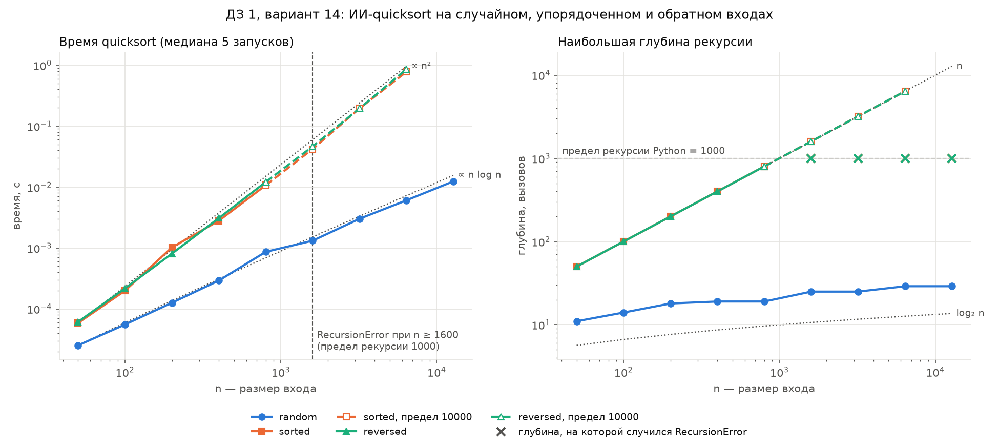

# Отчёт по ДЗ 1. Верификация ИИ-сгенерированной сортировки

**Вариант:** N = `14`
**Seed:** `30 + 14 = 44`
**Окружение:** Python `3.11`, CPU `12th Gen Intel(R) Core(TM) i5-12400F — 6 ядер.`

Проверяемый код — `dz01-ai-code.py`, неизменённая копия `Cases/attachments/dz01-ai-code.py` (до завершения верификации его исправлять нельзя). Код верификации — `case-01-ai-verification-sort.py`, запуск: `python COMPLETED-CASE-01/case-01-ai-verification-sort.py --variant 14`.

## 1. Проверяемый код и заявленные свойства

### 1.1. Проверяемый код

```python
def quicksort(data: list[int]) -> list[int]:
    if len(data) <= 1:
        return list(data)
    pivot = data[0]
    smaller = [x for x in data if x < pivot]
    larger = [x for x in data if x > pivot]
    return quicksort(smaller) + [pivot] + quicksort(larger)
```

Опорный элемент — первый элемент входа. Двумя списковыми включениями вход делится на элементы меньше и больше опорного. Обе части сортируются рекурсивно и склеиваются вокруг опорного в новый список. Массив из 0 или 1 элемента возвращается копией.

### 1.2. Заявленные свойства

| № | Свойство | Формулировка в docstring | Чем проверяется |
| --- | --- | --- | --- |
| 1 | Корректность: выход — элементы входа по неубыванию | «Sort a list of integers using the quicksort algorithm» | шаг 1 (инварианты), шаг 2 (классы входов), шаг 3 (сверка с `sorted()`) |
| 2 | Время O(n log n) | «Time complexity: O(n log n)» — в docstring и модуля, и функции | шаг 4: вывод для худшего случая, бенчмарк на случайном, упорядоченном и обратном входах |
| 3 | Стек рекурсии O(log n) | «space complexity: O(log n) for the recursion stack» | шаг 4: глубина рекурсии в худшем случае, поведение при росте n |
| 4 | Вход не меняется, возвращается новый список | «The input list is not modified; a new sorted list is returned» | шаги 2–3: вход сравнивается со своей копией после вызова |
| 5 | Примеры работы | `quicksort([3, 1, 2])` → `[1, 2, 3]`, `quicksort([])` → `[]` | `doctest` |

Оценка времени дана без оговорки «в среднем», то есть заявлена для любого входа. Поэтому на шаге 4 выводится именно худший случай. Эпитеты «Fast» и «Efficient» отдельно не проверяются: их содержание — свойство 2.

Свойство 5 подтверждается сразу: `python -m doctest -v COMPLETED-CASE-01/dz01-ai-code.py` — 2 из 2 примеров проходят. Но примеры покрывают только пустой вход и один короткий вход из различных чисел, а остальные классы входов (шаг 2) не затрагивают. Поэтому корректность они не доказывают.

## 2. Шаг 1 — инварианты сортировки

### 2.1. Реализация

```python
def is_sorted(a: list[int]) -> bool:
    return all(a[i] <= a[i + 1] for i in range(len(a) - 1))


def same_multiset(a: list[int], b: list[int]) -> bool:
    return Counter(a) == Counter(b)


def check_invariants(original: list[int], result: list[int]) -> list[str]:
    violations = []
    if not is_sorted(result):
        i = next(i for i in range(len(result) - 1) if result[i] > result[i + 1])
        violations.append(
            "инвариант 1 (упорядоченность): "
            f"result[{i}] = {result[i]} > result[{i + 1}] = {result[i + 1]}"
        )
    if not same_multiset(original, result):
        lost = Counter(original) - Counter(result)
        extra = Counter(result) - Counter(original)
        violations.append(
            f"инвариант 2 (перестановка): потеряно {lost.total()}, "
            f"лишних {extra.total()}; например, потеряны {sorted(lost)[:5]}, "
            f"лишние {sorted(extra)[:5]}"
        )
    return violations
```

- **Инвариант 1 — упорядоченность:** каждая пара соседей идёт по неубыванию. Сравнение `<=`, поэтому равные соседи допустимы.
- **Инвариант 2 — перестановка:** `Counter` считает, сколько раз встречается каждое значение. Счётчики входа и выхода должны совпасть, то есть совпадают и сами элементы, и их кратности. Сравнения `set` или длины для этого мало (см. 2.2).
- `check_invariants` возвращает список нарушений, пустой список означает «нарушений нет». Сообщение сразу локализует дефект: для инварианта 1 — первая пара соседей не по порядку, для инварианта 2 — сколько и каких значений потеряно или добавлено (разность `Counter` оставляет только положительные остатки). Нарушения не прерывают программу, а собираются: проверяемый код может их давать, и на шагах 2–3 нужно увидеть все.
- **Сложность:** `is_sorted` — Θ(n) времени и O(1) памяти; `same_multiset` — Θ(n) в среднем (хеш-таблица `Counter`) и Θ(n) памяти.

### 2.2. Проверка самих инвариантов

Прежде чем проверять ими чужой код, нужно убедиться, что верны сами проверки. Этим занимается `self_check`: в заготовке он был на `assert`, а переведён на `expect()` с исключением `SelfCheckError`, как в ЛР 3–4, потому что `assert` при запуске `python -O` молча пропускаются. Набор заведомо неверных выходов проверяет, что каждый из них нарушает ровно свои инварианты:

| Вход | Выход | Что моделирует | Нарушено |
| --- | --- | --- | --- |
| `[3, 1, 2]` | `[1, 2, 3]` | верная сортировка | — |
| `[3, 1, 2]` | `[3, 1, 2]` | элементы не переставлены | 1 |
| `[3, 1, 3]` | `[1, 3]` | потерян дубликат | 2 |
| `[2, 1]` | `[1, 2, 2]` | лишний элемент | 2 |
| `[2, 1]` | `[1, 1]` | элемент подменён, длина та же | 2 |
| `[2, 1]` | `[3, 0]` | другие элементы и не по порядку | 1 и 2 |

На 100 случайных массивах (длина 0–30, значения из `[−20, 20]`, поэтому много дубликатов и отрицательных) дополнительно проверяется:
- эталон `sorted(a)` проходит оба инварианта;
- выход `sorted(set(a))` всегда упорядочен, поэтому инвариант 1 его пропускает. Ловит его только инвариант 2, и ровно на тех массивах, где есть дубликаты;
- выход без сортировки (`a` как есть) — перестановка, поэтому инвариант 2 его пропускает. Ловит его только инвариант 1, если `a` не был упорядочен.

Проверено, что самопроверка ловит неверные реализации помощников: `<` вместо `<=` в `is_sorted`, `is_sorted`, всегда возвращающий `True`, и `same_multiset` через `set`, через сравнение длин и через их сочетание — все 5 подмен дают `SelfCheckError`. `self_check` проходит, в том числе под `python -O`.

## 3. Шаг 2 — репрезентативные тесты

### 3.1. Реализация

```python
LARGE_N = 2 * sys.getrecursionlimit()


def representative_cases(rng: random.Random) -> list[tuple[str, list[int]]]:
    def distinct(n: int) -> list[int]:
        return rng.sample(range(-(10**6), 10**6), n)

    cases = [
        ("граничный: пустой", []),
        ("граничный: один элемент", [7]),
        ("граничный: два по возрастанию", [1, 2]),
        ("граничный: два по убыванию", [2, 1]),
        ("граничный: два равных", [5, 5]),
    ]
    for n in (10, LARGE_N):
        cases += [
            ("вырожденный: все равны", [3] * n),
            ("вырожденный: отсортированный", sorted(distinct(n))),
            ("вырожденный: обратный", sorted(distinct(n), reverse=True)),
        ]
    cases.append(("типовой: случайный без дубликатов", distinct(1000)))
    for n, span in ((10, 5), (100, 50), (1000, 1000)):
        data = [rng.randint(-span, span) for _ in range(n)]
        cases.append(("типовой: случайный с дубликатами", data))
    return cases


def run_representative_tests(rng: random.Random) -> None:
    print("\nШаг 2. Репрезентативные тесты")
    found: dict[str, list[str]] = {}
    for name, data in representative_cases(rng):
        before = list(data)
        result = None
        try:
            result = quicksort(data)
        except Exception as exc:
            problems = [f"аварийное завершение: {type(exc).__name__}"]
        else:
            problems = check_invariants(before, result)
        if data != before:
            problems.append("вход изменён")
        print(f"  {name:<34} n={len(before):<5} {'; '.join(problems) or 'OK'}")
        if problems and result is not None and len(before) <= 10:
            print(f"  {'':<34} {before} -> {result}")
        for problem in problems:
            found.setdefault(problem.partition(" (")[0], []).append(
                f"{name}, n={len(before)}"
            )
    print("Какие классы входов вскрыли нарушения:")
    for problem, cases in found.items():
        print(f"  {problem} — входов: {len(cases)}")
        for case in cases:
            print(f"    {case}")
```

- **Классы входов** — по методике: граничные (0, 1, 2 элемента, включая два равных), вырожденные (все равны, отсортированный, обратный), типовые случайные. Случайные данные берутся из `rng` с seed = 44, так что прогон воспроизводится.
- **Каждый класс проверяет одно свойство входа.** Отсортированный и обратный входы составлены из различных чисел, а случайный вход есть и без дубликатов, и с ними. Так дубликаты и упорядоченность не смешиваются в одном входе, и по сводке видно, какое свойство вскрывает какой дефект. Отрицательные числа есть во всех случайных входах.
- **Вырожденные классы — в двух размерах.** При n = 10 выход виден целиком. При n = `LARGE_N` = 2000 проверяется заявленный стек O(log n): ему хватило бы ~11 вызовов, а 2000 — вдвое больше предела рекурсии Python (1000).
- **Что считается нарушением:** оба инварианта (раздел 2), изменение входа (свойство 4 из раздела 1.2) и аварийное завершение. Исключение перехватывается и записывается как результат, а прогон продолжается.

### 3.2. Результаты

| Класс входа | n | Результат |
| --- | --- | --- |
| граничный: пустой | 0 | OK |
| граничный: один элемент | 1 | OK |
| граничный: два по возрастанию / по убыванию | 2 | OK |
| граничный: два равных | 2 | `[5, 5]` → `[5]`: потерян 1 элемент (инвариант 2) |
| вырожденный: все равны | 10 / 2000 | выход `[3]`: потеряно 9 / 1999 (инвариант 2) |
| вырожденный: отсортированный, обратный | 10 | OK |
| вырожденный: отсортированный, обратный | 2000 | **`RecursionError`** |
| типовой: случайный без дубликатов | 1000 | OK |
| типовой: случайный с дубликатами | 10 / 100 / 1000 | потеряно 2 / 35 / 223 (инвариант 2) |

Найдено два независимых нарушения:

1. **Потеря элементов (инвариант 2)** — на всех 6 входах с повторяющимися значениями, и только на них. Выход меньше входа, а лишних элементов нет: пропадают именно повторы. Например, `[2, -5, -2, -4, -1, -2, 4, -5, 0, 5]` → `[-5, -4, -2, -1, 0, 2, 4, 5]` — исчезли второе `-5` и второе `-2`. Инвариант 1 не нарушен ни на одном входе: выход всегда упорядочен, поэтому проверка одной лишь упорядоченности признала бы код корректным. Граничные входы без повторов, упорядоченные входы из различных чисел и случайный вход без дубликатов этот дефект не вскрывают.
2. **Аварийное завершение `RecursionError`** — только на отсортированном и обратном входах из 2000 элементов. Те же классы при n = 10 и случайный вход из 1000 различных чисел проходят. Значит, глубина рекурсии зависит не только от n, но и от порядка входа: на упорядоченном входе она доходит до предела 1000 при n ≤ 2000, а не держится около log₂ n ≈ 11, как заявлено (свойство 3). Порог падения и рост времени разбираются в шаге 4.

Свойство «вход не меняется» не нарушено ни на одном входе. Причина потери элементов локализуется в шаге 3 (раздел 4), причина `RecursionError` — в шаге 4.

## 4. Шаг 3 — сравнение с эталоном `sorted()`

### 4.1. Реализация

```python
def reference_inputs(rng: random.Random, runs: int):
    for k in range(runs):
        max_n = (10, 100, 1000)[k % 3]
        span = (5, 100, 10**6)[k // 3 % 3]
        yield [rng.randint(-span, span) for _ in range(rng.randint(0, max_n))]


def compare_with_reference(rng: random.Random, runs: int = 300) -> None:
    print(f"\nШаг 3. Сверка с sorted() на {runs} случайных входах")
    inputs = {True: 0, False: 0}
    mismatches = {True: 0, False: 0}
    kinds: Counter[str] = Counter()
    dedup = 0
    counterexamples = []
    for data in reference_inputs(rng, runs):
        has_dups = len(set(data)) < len(data)
        inputs[has_dups] += 1
        result, error = call_sort(data)
        dedup += result == sorted(set(data))
        if result == sorted(data):
            continue
        mismatches[has_dups] += 1
        kinds[error or " и ".join(violated(data, result))] += 1
        counterexamples.append(data)
    for has_dups, label in ((True, "с дубликатами"), (False, "без дубликатов")):
        print(
            f"  входов {label}: {inputs[has_dups]}, "
            f"расхождений: {mismatches[has_dups]}"
        )
    for kind, count in kinds.items():
        print(f"  вид расхождения — {kind}: {count}")
    print(f"  выход совпал с sorted(set(вход)) на {dedup} из {runs} входов")
    if not counterexamples:
        print("  расхождений нет")
        return
    counterexamples.sort(key=len)
    print(f"  самые короткие расхождения (5 из {len(counterexamples)}):")
    for data in counterexamples[:5]:
        print(f"    {data} -> {call_sort(data)[0]}")
    minimal = shrink(counterexamples[0])
    print(f"  минимальный контрпример: {minimal} -> {call_sort(minimal)[0]}")
    localize(minimal)


def shrink(data: list[int]) -> list[int]:
    shrunk = True
    while shrunk:
        shrunk = False
        for i in range(len(data)):
            candidate = data[:i] + data[i + 1 :]
            if differs_from_reference(candidate):
                data, shrunk = candidate, True
                break
    return data


def trace_top_call(fn, data: list[int]) -> tuple[list[int], dict]:
    top, lines, state = [], [], {}

    def tracer(frame, event, arg):
        if event == "call":
            if frame.f_code is not fn.__code__ or top:
                return None
            top.append(frame)
        elif event == "line":
            lines.append(frame.f_lineno)
        elif event == "return":
            state.update(frame.f_locals)
            state["return"] = arg
        return tracer

    sys.settrace(tracer)
    try:
        fn(data)
    finally:
        sys.settrace(None)
    return list(dict.fromkeys(lines)), state
```

- **Входы** (`reference_inputs`). 300 случайных входов (`rng`, seed = 44) с отрицательными числами. Размер и диапазон значений перебираются по очереди в 9 сочетаниях: размер до 10, до 100 или до 1000; значения из `[−5, 5]`, `[−100, 100]` или `[−10⁶, 10⁶]`. Узкий диапазон даёт много дубликатов, широкий — почти без них. Расхождения считаются отдельно для входов с дубликатами и без них — так видно, от какого свойства входа зависит дефект.
- **Расхождение** — результат не равен `sorted(вход)` или вызов упал (`call_sort` перехватывает исключение и возвращает его имя). Вид расхождения определяется по нарушенным инвариантам (`violated`, раздел 2). Дополнительно считается, на скольких входах выход равен `sorted(set(вход))`, — это проверка гипотезы «теряются ровно повторы».
- **`shrink`** сводит самый короткий контрпример к минимальному: удаляет элементы по одному, пока расхождение с эталоном сохраняется. В итоге без любого элемента вход сортируется верно.
- **`trace_top_call`** локализует дефект по строкам. Через `sys.settrace` она отслеживает только внешний вызов `quicksort`: какие его строки выполнились и какие локальные переменные и результат были в момент возврата. Вложенные рекурсивные вызовы не трассируются. `localize` печатает эти строки с номерами по файлу `dz01-ai-code.py` (через `linecache`) и состояние вызова.

### 4.2. Результаты и локализация

| Входы | Число | Расхождений с `sorted()` |
| --- | --- | --- |
| с дубликатами | 146 | **146** (все — инвариант 2) |
| без дубликатов | 154 | 0 |

Выход совпал с `sorted(set(вход))` на **300 из 300** входов: код теряет ровно повторы и сохраняет по одному экземпляру каждого значения. Самые короткие расхождения — `[-2, -2, 4]` → `[-2, 4]` и `[2, 2, -1, 5]` → `[-1, 2, 5]`. Минимальный контрпример — **`[-2, -2]` → `[-2]`**. Трассировка внешнего вызова на нём:

```
строка 26: if len(data) <= 1:
строка 28: pivot = data[0]
строка 29: smaller = [x for x in data if x < pivot]
строка 30: larger = [x for x in data if x > pivot]
строка 31: return quicksort(smaller) + [pivot] + quicksort(larger)
data = [-2, -2]
smaller = []
larger = []
pivot = -2
return = [-2]
```

Потеря происходит в одном вызове, без рекурсии вглубь: на вход пришли 2 элемента, `smaller` и `larger` пусты, вернулся 1.

**Причина в коде:**
- **строки 29–30** — разбиение по строгим неравенствам `x < pivot` и `x > pivot`. Элемент, равный опорному, не проходит ни одно из условий и не попадает ни в `smaller`, ни в `larger`;
- **строка 31** — в результат возвращается только один `[pivot]`. Из `k` копий значения опорного остаётся одна, `k − 1` теряются.

Так происходит в каждом вызове. При разбиении все копии одного значения уходят в одну и ту же часть, поэтому в вызове, где значение становится опорным, лежат все его копии, и сохраняется одна. Отсюда выход = `sorted(set(вход))`. Выход при этом всегда упорядочен, поэтому дефект виден только по инварианту 2 и по сверке с эталоном. Чтобы его вскрыть, нужен вход с повтором, и минимальный такой вход — два равных элемента: входы из 0–1 элемента возвращаются копией (строка 27).

`RecursionError` в этой сверке не возник: на случайных входах первый элемент — случайный по рангу, разбиения в среднем сбалансированы, и глубина рекурсии далека от предела. Этот дефект вскрывают только упорядоченные входы (раздел 3.2), его причина разбирается в шаге 4.

## 5. Шаг 4 — сложность и производительность

### 5.1. Аналитическая оценка

Вызов на `m` элементах делает два прохода списковыми включениями (строки 29–30): `2m` сравнений с опорным, а также Θ(m) на построение `smaller`, `larger` и склейку результата (строка 31).

**Худший случай — упорядоченный вход.** Опорный `data[0]` (строка 28) на отсортированном входе оказывается минимумом: `smaller` пуст, в `larger` уходят все остальные `m − 1` элементов. На обратном входе — то же зеркально (опорный — максимум, пуст `larger`). Каждый вызов отделяет только опорный:

`T(n) = T(n − 1) + Θ(n)` → **Θ(n²)**; точно `2·(n + (n − 1) + … + 2) = n(n + 1) − 2` сравнений.

- **Глубина рекурсии** — цепочка вызовов на `n, n − 1, …, 1` элементах, то есть **n**. Предел рекурсии Python — 1000, поэтому на упорядоченном входе из ~1000 элементов программа падает с `RecursionError`.
- **Память** — каждый незавершённый вызов держит свои списки `data` и `larger`. Вдоль цепочки одновременно живут списки длиной `n, n − 1, …, 1`, это **Θ(n²)**.

**Средний случай — случайный порядок.** Ранг `data[0]` равновероятен, разбиения в среднем сбалансированы: ожидаемо Θ(n log n) времени (≈ 2 · 1,39 · n log₂ n сравнений — проходов два), глубина Θ(log n), память Θ(n).

| Случай | Вход | Время | Глубина рекурсии | Доп. память |
| --- | --- | --- | --- | --- |
| средний | случайный порядок | Θ(n log n) | Θ(log n) | Θ(n) |
| **худший** | отсортированный, обратный | **Θ(n²)** | **n** | **Θ(n²)** |
| заявлено в docstring | любой | O(n log n) | O(log n) | — |

Свойства 2 и 3 из раздела 1.2 выполняются только в среднем случае, а заявлены без оговорок. Причина — строка 28: опорный выбирается по позиции, поэтому худшим случаем оказывается самый частый на практике вход — уже упорядоченный.

### 5.2. Методика замеров

```python
def make_input(rng: random.Random, n: int, kind: str) -> list[int]:
    a = rng.sample(range(-(10**6), 10**6), n)
    if kind == "sorted":
        a.sort()
    elif kind == "reversed":
        a.sort(reverse=True)
    return a


def max_depth(fn, data: list[int]) -> int:
    depth = deepest = 0

    def profiler(frame, event, _arg):
        nonlocal depth, deepest
        if frame.f_code is not fn.__code__:
            return
        if event == "call":
            depth += 1
            deepest = max(deepest, depth)
        elif event == "return":
            depth -= 1

    sys.setprofile(profiler)
    try:
        fn(data)
    except RecursionError:
        pass
    finally:
        sys.setprofile(None)
    return deepest


def measure(kind: str, data: list[int]) -> dict:
    rec = {
        "kind": kind,
        "n": len(data),
        "limit": sys.getrecursionlimit(),
        "time_s": None,
        "depth": max_depth(quicksort, data),
        "peak_kib": None,
        "error": None,
    }
    head = f"  n={rec['n']:>6}  предел={rec['limit']:<6}"
    try:
        rec["time_s"] = bench(quicksort, data)
    except RecursionError:
        rec["error"] = "RecursionError"
        print(f"{head} RecursionError на глубине {rec['depth']}")
        return rec
    rec["peak_kib"] = peak_memory(quicksort, data) / 1024
    print(
        f"{head} t={rec['time_s']:.6f} c  глубина={rec['depth']:<5} "
        f"пик памяти={rec['peak_kib']:.0f} КиБ"
    )
    return rec


def run_benchmarks(seed: int) -> list[dict]:
    rng = random.Random(seed)
    records = []
    for kind in INPUT_KINDS:
        print(f"\nкласс входа: {kind}")
        for n in SIZES:
            data = make_input(rng, n, kind)
            records.append(measure(kind, data))
            if records[-1]["error"] and n <= RAISED_MAX_N:
                with recursion_limit(RAISED_LIMIT):
                    records.append(measure(kind, data))
    return records
```

- **Классы и размеры.** Случайный, отсортированный и обратный входы. `n` = 50, 100, …, 12 800 — 9 размеров с шагом ×2, так что на упорядоченных входах до падения успевают 5 точек. Числа различные (в заготовке были `randint(−1000, 1000)` с дубликатами): на дубликатах ИИ-код теряет элементы и сортирует меньше, чем получил, а глубина его рекурсии ограничена числом различных значений. С различными числами время зависит только от выбора опорного.
- **Время** — `bench` из заготовки: прогрев, 5 повторов, медиана `time.perf_counter()`.
- **Глубина рекурсии** — `max_depth`: `sys.setprofile` считает входы и выходы из `quicksort`. При `RecursionError` это глубина, на которой переполнился стек.
- **Пик памяти** — `peak_memory`: `tracemalloc` во время одного вызова (вместе с результатом).
- Глубина и память меряются в отдельных запусках, не попадающих в замер времени.
- **Аварийное завершение** записывается как результат. Упавшая точка при `n ≤ 6400` перемеряется с пределом рекурсии 10 000 (`recursion_limit` временно меняет предел и восстанавливает его): так видно, что будет на упорядоченном входе, если стек не ограничивать. Дальше 6400 не идём из-за памяти Θ(n²): при `n = 12 800` пик около 670 МиБ.
- **Сводка** — наклон прямой МНК в осях log-log (`statistics.linear_regression`) по всем успешным точкам класса и первый `n` с `RecursionError`. График — две панели в осях log-log (время и глубина) с опорными линиями `n log n`, `n²`, `n`, `log₂ n` и пределом рекурсии: `plots/case01_variant14_loglog.png`. Сырые данные — `plots/case01_variant14_results.json`.

### 5.3. Результаты

Программа запускалась 6 раз: первый запуск — прогревочный и в результаты не входит, за ним 5 зачётных. Глубина рекурсии и память детерминированы и во всех запусках совпали. Наклоны ниже — разброс по 5 зачётным запускам; таблица времени и график — последний из них.



**Время, мс (медиана 5 запусков)** — `*` замер с пределом рекурсии 10 000, RE — `RecursionError` при обычном пределе 1000

| n | random | sorted | reversed |
| --- | --- | --- | --- |
| 50 | 0,025 | 0,059 | 0,061 |
| 100 | 0,055 | 0,199 | 0,217 |
| 200 | 0,126 | 1,02 | 0,807 |
| 400 | 0,292 | 2,80 | 3,09 |
| 800 | 0,864 | 10,7 | 12,1 |
| 1600 | 1,32 | RE; 42,1* | RE; 46,4* |
| 3200 | 3,02 | RE; 196* | RE; 196* |
| 6400 | 6,06 | RE; 781* | RE; 859* |
| 12 800 | 12,4 | RE | RE |

**Глубина рекурсии / пик памяти, КиБ**

| n | random | sorted | reversed |
| --- | --- | --- | --- |
| 50 | 11 / 3 | 50 / 17 | 50 / 14 |
| 200 | 18 / 8 | 200 / 206 | 200 / 193 |
| 800 | 19 / 27 | 800 / 2 832 | 800 / 2 782 |
| 1600 | 25 / 57 | RE на глубине 992; 1600 / 10 952* | RE на глубине 992; 1600 / 10 852* |
| 6400 | 29 / 201 | RE на глубине 992; 6400 / 171 306* | RE на глубине 992; 6400 / 170 906* |
| 12 800 | 29 / 424 | RE на глубине 992 | RE на глубине 992 |

**Наклоны в осях log-log**

| Класс входа | Наклон (5 запусков) | Ожидание |
| --- | --- | --- |
| random | 1,11–1,13 | `n log n` на этой сетке размеров — 1,16 |
| sorted | 1,84–1,96 | `n²` — 2 |
| reversed | 1,91–1,97 | `n²` — 2 |

- **Случайный вход — заявленная оценка выполняется.** Наклон 1,11–1,13 близок к 1,16 у `n log n` на той же сетке, время растёт примерно вдвое при удвоении `n`. Глубина 11–29 ≈ 2 · log₂ n, память при удвоении `n` растёт в среднем вдвое — Θ(n).
- **Упорядоченный и обратный входы — Θ(n²).** Наклон 1,84–1,97. При больших `n` время растёт вчетверо на каждое удвоение (196 → 781 мс). При `n = 800` это в 12 раз медленнее случайного входа, при `n = 6400` — в 129 раз. Наклон чуть ниже 2, потому что на малых `n` заметна линейная часть работы (вызов функции, создание списков).
- **Стек.** Глубина рекурсии равна ровно `n`, а не O(log n), как заявлено. Падение происходит на глубине 992: это предел 1000 минус кадры самой программы проверки (`main`, `run_benchmarks`, `measure` и др.), то есть порог — `n ≈ 1000`. На сетке размеров первая упавшая точка — 1600.
- **Поднятый предел рекурсии — не исправление.** С пределом 10 000 падение исчезает, но время остаётся квадратичным, а память растёт вчетверо на каждое удвоение `n`: 167 МиБ при `n = 6400` против 0,2 МиБ на случайном входе. Это сходится с оценкой раздела 5.1: `n²/2` ссылок по 8 байт ≈ 156 МиБ плюс запас ёмкости списков.
- **Выбросы.** В 4-м зачётном запуске sorted при `n = 50` занял 0,139 мс вместо 0,059–0,061 мс, отсюда наклон 1,84; в остальных зачётных запусках 1,95–1,96. В последнем запуске (он на графике) выбиваются random при `n = 800` (0,864 мс против 0,586–0,622 мс в других зачётных запусках) и sorted при `n = 200` (1,02 мс против 0,75–0,92 мс) — фоновая нагрузка на долях миллисекунды. На графике это видно как изломы, на наклон влияет слабо.

**Вывод шага 4.** Свойства 2 и 3 (раздел 1.2) верны только для случайного входа. На отсортированном и обратном входах время Θ(n²), глубина рекурсии n с падением при `n ≈ 1000`, память Θ(n²). Тесты корректности этого не обнаруживают: на случайных входах код быстрый, а на маленьких упорядоченных — корректный. Причина — строка 28, `pivot = data[0]`.

## 6. Найденные дефекты

| | **Д1. Потеря элементов, равных опорному** | **Д2. Деградация до Θ(n²) и переполнение стека** |
| --- | --- | --- |
| Симптом | Выход короче входа, но всегда упорядочен: от каждого значения остаётся одна копия, выход = `sorted(set(вход))`. Минимальный пример: `[-2, -2]` → `[-2]`. Ошибки нет — неверный результат возвращается молча. | На упорядоченном входе время растёт как n² (наклон 1,84–1,97; при `n = 6400` в 129 раз медленнее случайного входа), глубина рекурсии равна `n`, и при `n ≈ 1000` программа падает с `RecursionError`. С поднятым пределом рекурсии падения нет, но память растёт как n² (167 МиБ при `n = 6400`). |
| Какой класс входов вскрыл | Любой вход с повторяющимися значениями: граничный «два равных», вырожденный «все равны», случайные с дубликатами (6 из 6 таких входов в шаге 2, 146 из 146 в шаге 3). | Отсортированный и обратный входы: падение — при `n = 2000` в шаге 2 и с `n = 1600` в шаге 4, квадратичный рост — на всех размерах в шаге 4. |
| Почему другие классы не вскрыли | Без повторов теряться нечему: 0–2 различных элемента, упорядоченные входы из различных чисел, случайный вход без дубликатов (154 из 154 без расхождений) и оба примера из docstring проходят. Проверка одной упорядоченности его не видит — инвариант 1 не нарушен ни разу. | На случайном входе `data[0]` — случайный по рангу, разбиения в среднем сбалансированы: глубина ≈ 2 · log₂ n (29 при `n = 12 800`), время ≈ n log n. Упорядоченные входы из 10 элементов проходят: глубина 10, время незаметно. Тесты корректности и сверка с `sorted()` на случайных входах проверяют результат, а не цену его получения. |
| Причина в коде | Строки 29–30: строгие `x < pivot` и `x > pivot` — элемент, равный опорному, не попадает ни в одну часть. Строка 31 возвращает только один `[pivot]`. | Строка 28: опорный выбирается по позиции, `data[0]`. На отсортированном входе это минимум (на обратном — максимум), разбиение отделяет только его, и строка 31 рекурсивно вызывается на `m − 1` элементах: `T(n) = T(n − 1) + Θ(n)`, глубина `n`. |
| Где найден | шаг 1 (инвариант 2), шаг 2 (раздел 3.2), шаг 3 с локализацией трассировкой (раздел 4.2) | шаг 2 (раздел 3.2), шаг 4 — анализ (5.1) и замеры (5.3) |
| Нарушенные свойства (раздел 1.2) | 1 — корректность | 2 — время O(n log n), 3 — стек O(log n) |
| Последствия | Порча данных на любом реальном входе с повторами, без сигнала об ошибке. | Аварийное завершение на уже отсортированных данных от ~1000 элементов — самом частом на практике «неудобном» входе. |

Дефекты независимы, и у каждого своя строка-причина:

| Строка | Код | Дефект |
| --- | --- | --- |
| 28 | `pivot = data[0]` | Д2 |
| 29 | `smaller = [x for x in data if x < pivot]` | Д1 |
| 30 | `larger = [x for x in data if x > pivot]` | Д1 |
| 31 | `return quicksort(smaller) + [pivot] + quicksort(larger)` | Д1 (один `[pivot]`), Д2 (рекурсия по части из `m − 1` элементов) |

Поэтому каждый класс входов вскрывает ровно свой дефект: дубликаты — Д1, упорядоченность — Д2. На входе, где есть и то и другое, Д1 частично маскирует Д2: потерянные копии не уходят в рекурсию, и глубина ограничена числом различных значений, а не `n`. По этой причине в шаге 4 упорядоченные входы составлены из различных чисел (раздел 5.2).

## 7. Вердикт о применимости

### 7.1. Итог проверки заявленных свойств

| № | Свойство из docstring (раздел 1.2) | Результат | Основание |
| --- | --- | --- | --- |
| 1 | Корректность | **нарушено** (Д1) | шаг 1: нарушен инвариант 2; шаг 2: 6 из 6 входов с повторами; шаг 3: 146 из 146 расхождений с `sorted()` |
| 2 | Время O(n log n) | **только в среднем**; худший случай Θ(n²) (Д2) | шаг 4: наклон 1,11–1,13 на случайном входе, 1,84–1,97 на упорядоченных |
| 3 | Стек O(log n) | **только в среднем**; худший случай — глубина n, `RecursionError` (Д2) | шаги 2 и 4: глубина 11–29 на случайном входе, ровно `n` на упорядоченных |
| 4 | Вход не меняется | выполнено | шаги 2–3: вход ни разу не изменился |
| 5 | Примеры из docstring | выполнено, но корректности не доказывают | `doctest`: 2 из 2 |

Сверх заявленного: дополнительная память — Θ(n) в среднем и Θ(n²) в худшем случае (раздел 5).

### 7.2. Вердикт: **принять с доработкой**

**В текущем виде использовать нельзя.** Д1 молча портит результат на любом входе с повторами. Д2 роняет программу на уже отсортированных данных от ~1000 элементов. Заявления о сложности даны без оговорки «в среднем» и для худшего случая ложны.

**Отклонять не нужно.** Основа решения верна: схема «разбить по опорному — отсортировать части — склеить» правильная, и входы без повторов, где не срабатывает Д2, сортируются верно: 154 из 154 в шаге 3 и все такие входы шага 2, кроме упорядоченных из 2000 элементов. На случайном входе время растёт как n log n, вход не меняется. Оба дефекта локализованы до строк 28–31 (раздел 6) и устраняются без смены алгоритма и интерфейса `quicksort(data) -> list`. Вердикт «отклонить» был бы оправдан, если бы дефекты не локализовались, исправление требовало другого алгоритма или код противоречил бы контракту в целом.

**Условия принятия:**
1. **Д1** — собирать элементы, равные опорному, в отдельный список и возвращать их все (трёхчастное разбиение `< · = · >`).
2. **Д2** — выбирать опорный случайно, а не по позиции. Тогда ожидаемое время Θ(n log n) и глубина O(log n) будут на любом входе, включая упорядоченный.
3. **Docstring** — указать, что оценки ожидаемые (по случайному выбору опорного): худший случай Θ(n²) остаётся теоретически возможным, а дополнительная память — Θ(n), а не только стек.
4. **Повторная полная верификация** исправленной копии по шагам 1–4 на тех же входах (раздел 8). Принять код можно только после неё.
