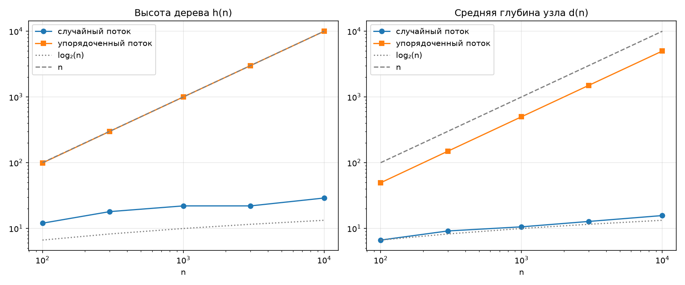

# Отчёт по ДЗ 2. Эксперимент: высота BST и деградация операций

**Вариант:** N = `14`
**Seed:** `30 + 14 = 44`
**Окружение:** Python `3.11`, CPU `12th Gen Intel(R) Core(TM) i5-12400F — 6 ядер.`

Код — в файле `case-02-bst-height-experiment.py`, запуск: `python COMPLETED-CASE-02/case-02-bst-height-experiment.py --variant 14`. Код отформатирован `black` и проверен `pylint`.

## 1. Высота и средняя глубина узла

### 1.1. Реализация

```python
def insert_iter(root: Node | None, key: int) -> Node:
    parent, cur = None, root
    while cur is not None:
        if key == cur.key:
            return root
        parent = cur
        cur = cur.left if key < cur.key else cur.right
    node = Node(key)
    if parent is None:
        return node
    if key < parent.key:
        parent.left = node
    else:
        parent.right = node
    return root


def tree_height(root: Node | None) -> int:
    height = -1
    stack = [(root, 0)]
    while stack:
        node, depth = stack.pop()
        if node is not None:
            height = max(height, depth)
            stack.append((node.left, depth + 1))
            stack.append((node.right, depth + 1))
    return height


def avg_depth(root: Node | None) -> float:
    n = count_nodes(root)
    return sum_depths(root) / n if n else 0.0
```

`Node` — тот же, что в ЛР 5. Рекурсивная вставка ЛР 5 на упорядоченном потоке падает с `RecursionError`: глубина цепочки больше предела в 1000 кадров. Поэтому `insert_iter` спускается циклом, запоминая родителя, и подвешивает к нему новый лист (лекция 5, §4).

Обходы — со стеком пар `(узел, глубина)`: `tree_height` берёт максимум глубин, `sum_depths` — сумму, `count_nodes` считает узлы, `avg_depth` — их частное. Итеративный `inorder_keys` нужен для сверки с `sorted()` — раздел 6.

- **Время:** `insert_iter` — O(h); построение дерева — Θ(n log n) в среднем на случайном потоке, Θ(n²) на упорядоченном; обходы — Θ(n).
- **Память:** `insert_iter` — O(1), стек обхода — O(h).

### 1.2. Замеры

Случайный поток — `rng.sample(range(10 * n), n)` при `rng = random.Random(44)`, упорядоченный — `1, 2, …, n`; по одному дереву на каждое `n`. Перед замерами — `self_check: OK`.

| n | h, случайный | d, случайный | h, упорядоченный | d, упорядоченный | log₂ n |
| --- | --- | --- | --- | --- | --- |
| 100 | 12 | 6,6 | 99 | 49,5 | 6,6 |
| 300 | 18 | 9,1 | 299 | 149,5 | 8,2 |
| 1 000 | 22 | 10,6 | 999 | 499,5 | 10,0 |
| 3 000 | 22 | 12,8 | 2 999 | 1 499,5 | 11,6 |
| 10 000 | 29 | 15,7 | 9 999 | 4 999,5 | 13,3 |

h — высота в рёбрах, d — средняя глубина узла.

- **Упорядоченный поток:** ровно `h = n − 1` и `d = (n − 1)/2` — цепочка.
- **Случайный поток:** при росте `n` в 100 раз h и d выросли в 2,4 раза — порядок log₂ n (сравнение — в разделе 2). Высота одного дерева колеблется: при `n = 1000` и `3000` она одинакова.

## 2. Графики h(n) и d(n)



Графики строит `plot_results` по значениям таблицы раздела 1. Оси log-log: n — прямая с наклоном 1, log₂ n — почти горизонтальная кривая.

- **Упорядоченный поток** — на прямой n: `h = n − 1` с ней совпадает, `d = (n − 1)/2` идёт параллельно вдвое ниже. Обе величины линейны по n.
- **Случайный поток** идёт параллельно log₂ n — отношение к log₂ n почти постоянно:

| n | h / log₂ n | d / log₂ n | d | d, теория |
| --- | --- | --- | --- | --- |
| 100 | 1,81 | 1,00 | 6,64 | 6,48 |
| 300 | 2,19 | 1,11 | 9,14 | 8,61 |
| 1 000 | 2,21 | 1,06 | 10,56 | 10,99 |
| 3 000 | 1,90 | 1,10 | 12,75 | 13,17 |
| 10 000 | 2,18 | 1,18 | 15,67 | 15,58 |

Теория — средняя глубина по всем порядкам вставки `2(n + 1)·H(n)/n − 4`, `H(n) = 1 + ½ + … + 1/n` (лекция 5, разбор 2); замер отличается от неё не больше чем на 6 %. Асимптотически это ≈ 1,39·log₂ n, при наших n отношение меньше (1,0–1,2) из-за слагаемого −4. Высота ≈ 2·log₂ n — самый глубокий узел примерно вдвое глубже среднего; при `n = 10⁴` она 29, в лекции на 100 случайных деревьях — от 26 до 37.

При `n = 10⁴` упорядоченное дерево выше случайного в 345 раз (9 999 против 29).

## 3. Деградация операций на упорядоченном потоке

### 3.1. Почему O(n)

- `search`, `insert` и `delete` проходят один путь от корня вниз: поиск — до ключа или пустой ссылки, вставка — неудачный поиск и подвешивание листа, удаление — спуск к узлу и дальше к преемнику. Узлов на пути не больше h + 1, время — O(h).
- На упорядоченном потоке каждый новый ключ больше всех вставленных: на каждом узле спуск уходит вправо, и ключ становится правым ребёнком последнего. У каждого узла только правый ребёнок — дерево вырождается в односвязный список, `h = n − 1` (раздел 1).
- Поэтому O(h) = O(n): поиск ключа k проходит k узлов, отсутствующего ключа больше n — все n; вставка следующего ключа — все n. Построение дерева стоит 0 + 1 + … + (n − 1) = n(n − 1)/2 сравнений — Θ(n²). Рекурсивные `insert` и `delete` ЛР 5 вдобавок уходят на глубину h и падают с `RecursionError` при h ≈ 1000.
- На случайном потоке h = Θ(log n) (раздел 2), и те же операции стоят O(log n).

### 3.2. Замер поиска

```python
queries = random.choices(range(10 * n), k=QUERIES)
t_rand = bench_search(root_rand, queries)
t_ord = bench_search(root_ord, queries)
```

Оба дерева ищут одни и те же 1000 ключей из `[0, 10n)`. Запросы берутся из глобального `random` (seed 44 задан в `main`), а не из `rng`, чтобы не сдвинуть ключи деревьев из раздела 1. `bench_search` из заготовки делает прогрев и возвращает медиану 5 замеров. Программа запускалась 6 раз, первый запуск — прогрев и не учитывается; в таблице — медиана по прогонам 2–6, в скобках — разброс.

Время 1000 поисков:

| n | t, случайный, мс | t, упорядоченный, мс | t_упор / t_случ |
| --- | --- | --- | --- |
| 100 | 0,262 (0,257–0,272) | 2,67 (2,49–2,80) | 10 (10–11) |
| 300 | 0,387 (0,348–0,586) | 7,87 (7,65–8,32) | 20 (14–24) |
| 1 000 | 0,424 (0,410–0,440) | 25,2 (24,8–25,6) | 59 (57–61) |
| 3 000 | 0,484 (0,475–0,551) | 76,6 (76,0–77,2) | 158 (140–160) |
| 10 000 | 0,585 (0,576–0,596) | 261,4 (258,9–264,0) | 447 (434–458) |

- **Упорядоченное дерево — Θ(n).** 90 % запросов больше n и проходят цепочку целиком, остальные — в среднем n/2 узлов: всего ≈ 0,95n узлов на поиск. На узел — 26–28 нс при всех n, поэтому при росте n в 100 раз время выросло в 98 раз.
- **Случайное дерево — O(log n).** Почти все запросы отсутствуют и доходят до пустой ссылки — около d + 2 узлов (от 9 до 18). На узел — 30–35 нс, время выросло в 2,2 раза.
- **Разрыв** растёт с 10 до 447 раз — Θ(n) против O(log n). Время на узел почти одинаково, поэтому время поиска пропорционально длине пути, то есть высоте.
