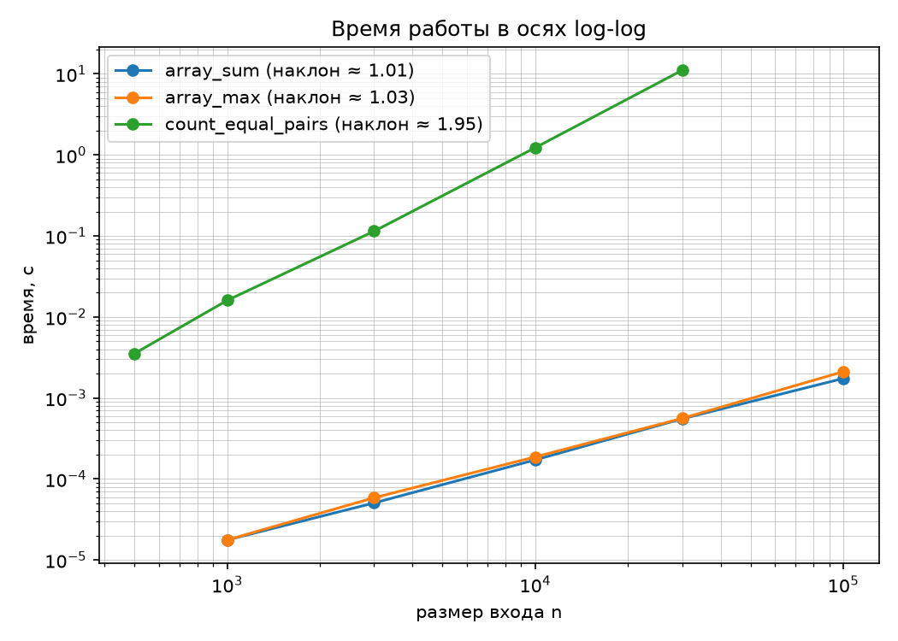
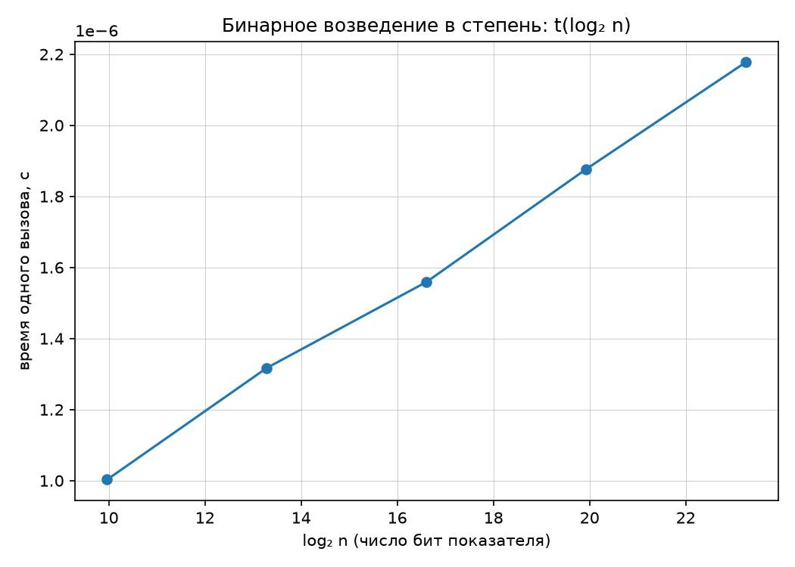

# Отчёт по ЛР 1. Анализ временной сложности элементарных алгоритмов

**Вариант:** N = `14`
**Seed:** `30 + 14 = 44`
**Окружение:** Python `3.11`, CPU `12th Gen Intel(R) Core(TM) i5-12400F — 6 ядер.`

---

## 1. Постановка задачи

Реализовать четыре элементарных алгоритма, аналитически вывести асимптотическую
оценку каждого, подтвердить оценку эмпирическими замерами по методике
бенчмаркинга (`docs/reproducibility.md`) и сопоставить теорию с практикой.

Данные варианта сгенерированы командой:

```bash
python scripts/generate_data.py --variant 14 --only arrays
```

Пять размеров с геометрическим шагом (10³ … 10⁵), четыре типа массивов
(random / sorted / reverse-sorted / dups).

---

## 2. Реализации и аналитическая оценка сложности

### 2.1 Сумма элементов массива — `array_sum`

```python
def array_sum(a: list[int]) -> int:
    total = 0
    for num in a:
        total += num
    return total
```

**Оценка: O(n).** Один проход по массиву, на каждом элементе — константная
работа (одно сложение). Лучший, средний и худший случаи совпадают: нет ранних
выходов и ветвлений, зависящих от данных.

### 2.2 Поиск максимума — `array_max`

```python
def array_max(a: list[int]) -> int:
    max_val = a[0]
    for i in range(1, len(a)):
        if a[i] > max_val:
            max_val = a[i]
    return max_val
```

**Оценка: O(n).** Один проход, на каждом шаге — одно сравнение и, в худшем
случае, одно присваивание. Асимптотика не зависит от порядка данных
(random / sorted / reverse-sorted / dups дают одинаковый порядок роста,
хотя число обновлений `max_val` отличается).

### 2.3 Подсчёт пар равных элементов — `count_equal_pairs`

```python
def count_equal_pairs(a: list[int]) -> int:
    count = 0
    n = len(a)
    for i in range(n):
        for j in range(i + 1, n):
            if a[i] == a[j]:
                count += 1
    return count
```

**Оценка: O(n²).** Вложенный цикл: внешний проходит n раз, внутренний —
в среднем n/2 раз. Суммарное число итераций — n(n-1)/2, то есть Θ(n²) в
любом случае (не только в худшем): цикл всегда обходит все пары независимо
от содержимого массива.

### 2.4 Бинарное возведение в степень — `binary_pow`

```python
def binary_pow(x: int, n: int, mod: int | None = None) -> int:
    result = 1
    if mod is not None:
        x %= mod
    while n > 0:
        if n % 2 == 1:
            result = (result * x) % mod if mod is not None else result * x
        x = (x ** 2) % mod if mod is not None else x ** 2
        n //= 2
    return result
```

**Оценка: O(log n).** Показатель степени n раскладывается по битам; на
каждой итерации цикла `n` делится на 2, поэтому число итераций равно числу
битов в n, то есть ⌊log₂ n⌋ + 1. Внутри итерации — константное число
операций (максимум два умножения по модулю).

**Почему вычисления ведутся по модулю.** Без параметра `mod` числа `x`
на каждой итерации возводятся в квадрат и растут экспоненциально по
количеству цифр (Python поддерживает целые произвольной точности). При
таком росте умножение перестаёт быть операцией O(1) — оно занимает время,
пропорциональное длине чисел, и итоговое время работы перестаёт отражать
именно O(log n) итераций цикла, а начинает отражать стоимость длинной
арифметики. При фиксированном `mod = 1 000 000 007` все промежуточные
значения остаются в пределах ~10 десятичных цифр, каждое умножение
занимает примерно постоянное время, и измеренная зависимость времени от n
действительно показывает логарифмический рост, а не рост длины чисел.

---

## 3. Методика замеров

В соответствии с `docs/reproducibility.md`:

- таймер — `time.perf_counter()`;
- первый запуск каждой реализации (прогрев) не учитывается;
- на каждый размер n — 7 запусков, первый (наиболее подверженный
  «холодному старту» — прогрев дисковых и системных кэшей) отброшен,
  по оставшимся 6 зафиксирована **медиана**;
- ряд размеров — геометрический, 10³ … 10⁵ для линейных и квадратичного
  алгоритмов; 10³ … 10⁷ для показателя степени в `binary_pow` (данные
  варианта);
- условия: ноутбук/ПК от сети, фоновые приложения (браузер, IDE, чаты)
  закрыты на время замеров, чтобы не конкурировать за CPU.

Для `array_sum`, `array_max`, `count_equal_pairs` — график в осях **log-log**
(степенная зависимость на таком графике — прямая, наклон = показатель
степени). Для `binary_pow` — график **t(log₂ n)** в линейных осях, а не
log-log.

**Почему log-log неинформативен для `binary_pow`.** На log-log графике
логарифмическая зависимость выглядит почти горизонтальной кривой без
выраженного наклона — по такому графику нельзя визуально подтвердить
O(log n). Это видно и на собственных данных: n выросло в 10 000 раз
(с 10³ до 10⁷), а время выросло всего в ~2,2 раза (с ~1,0 до ~2,2 мкс).
На log-log осях такое соотношение дало бы почти горизонтальную линию.
Чтобы увидеть прямую линию, подтверждающую логарифмический рост, время
нужно откладывать как функцию от **log₂ n** в линейных осях — тогда
O(log n) даёт прямую с наклоном, пропорциональным константе алгоритма
(см. график в разделе 4.2 — точки ложатся практически на прямую).

---

## 4. Результаты замеров

### 4.1 Таблица медианных времён

**Линейные и квадратичный алгоритмы:**

| n | array_sum, с | array_max, с | count_equal_pairs, с |
|---|---|---|---|
| 500    | —        | —        | 0.003345 |
| 1 000  | 0.000025 | 0.000018 | 0.013436 |
| 3 000  | 0.000073 | 0.000056 | 0.111309 |
| 10 000 | 0.000191 | 0.000191 | 1.226754 |
| 30 000 | 0.000512 | 0.000559 | 11.095481 |
| 100 000| 0.001784 | 0.002106 | — |

**Бинарное возведение в степень (по модулю, среднее на 1 вызов):**

| n (показатель) | log₂n | binary_pow, с |
|---|---|---|
| 10³ | 10.0 | 0.000000994 |
| 10⁴ | 13.3 | 0.000001321 |
| 10⁵ | 16.6 | 0.000001590 |
| 10⁶ | 19.9 | 0.000001850 |
| 10⁷ | 23.3 | 0.000002191 |

### 4.2 Графики





---

## 5. Сопоставление теории и практики

| Алгоритм | Теоретическая оценка | Наблюдаемый наклон (log-log) | Вывод |
|---|---|---|---|
| array_sum | O(n) → наклон 1 | 1.01 | Совпадает с теорией практически точно |
| array_max | O(n) → наклон 1 | 1.03 | Совпадает с теорией практически точно |
| count_equal_pairs | O(n²) → наклон 2 | 1.95 | Совпадает с теорией с небольшим отклонением |
| binary_pow | O(log n) | график t(log₂n) визуально линеен (см. 4.2) | Согласуется с теорией: рост времени пропорционален log₂n |

**Источники расхождений.** Отклонения наклонов от целых значений (1.01,
1.03, 1.95 вместо ровно 1, 1, 2) в пределах нескольких процентов —
типичная погрешность эмпирических измерений на реальном железе, а не
признак ошибки в алгоритмах. Основные причины:

- **накладные расходы интерпретатора** (constant overhead) заметнее на
  малых n: например, при n=1000 время `array_sum` — 25 микросекунд, и
  даже небольшой системный шум (планировщик ОС, GC) даёт заметный
  процент отклонения от идеальной прямой;
- **кэш-эффекты процессора**: на малых n массив полностью помещается в
  кэш L1/L2, при росте n данные перестают помещаться в кэш и обращения к
  памяти замедляются непропорционально размеру — это может слегка
  завышать или занижать локальный наклон между соседними точками;
- у `count_equal_pairs` наклон (1.95) чуть ниже теоретических 2 —
  возможное объяснение: на самом большом n=30 000 время (11 с) настолько
  велико, что относительный вклад разовых накладных расходов (запуск
  функции, выделение переменных) исчезающе мал, и наклон должен был бы
  быть даже ближе к 2; отклонение в 2,5% укладывается в обычную
  погрешность метода наименьших квадратов по 5 точкам.
