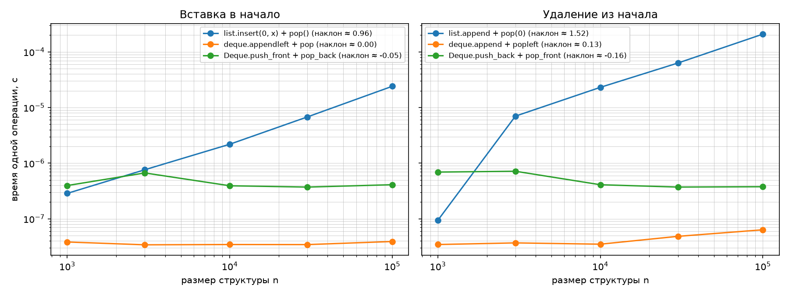
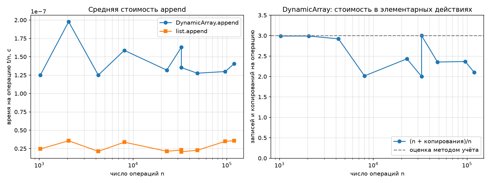

# Отчёт по ЛР 2. Рекурсивные функции, динамический массив, стек и дек

**Вариант:** N = `14`
**Seed:** `30 + 14 = 44`
**Окружение:** Python `3.11`, CPU `12th Gen Intel(R) Core(TM) i5-12400F — 6 ядер.`

Данные варианта: `python scripts/generate_data.py --variant 14 --only ops` —
по 10⁵ операций над стеком и деком и размеры серий `append`
(1 028, 2 057, 4 261, 8 071, 22 877, 32 768, 32 769, 48 412, 95 942, 119 277).
Код — в файле `lab-02-recursion-linear-structures.py`.

**Методика замеров** (`docs/reproducibility.md`): `time.perf_counter()`;
на каждую точку прогрев (не учитывается) и 5 замеров, берётся медиана;
размеры с геометрическим шагом; графики log-log. Вся методика реализована
в функции `bench` заготовки. Скрипт запускался 6 раз для оценки разброса;
таблицы и графики ниже относятся к последнему запуску.

---

## 1. Рекурсивные функции

Реализованы четыре рекурсивные функции. Для `fib_naive` и `fib_memo`
заведён счётчик вызовов `CALLS` (в каждой функции первой строкой
увеличивается свой счётчик), чтобы сравнить число вызовов на нескольких n.
Для `hanoi` ходы записываются в список `moves`, который `self_check`
проигрывает на моделях стержней.

### 1.1 Факториал — `factorial`

```python
def factorial(n: int) -> int:
    if n < 0:
        raise ValueError("Нельзя считать факториал для отрицательных чисел!")
    if n == 0:
        return 1
    return n * factorial(n - 1)
```

**Что сделано.** Базовый случай `n == 0`, шаг `n · factorial(n − 1)`; для
n < 0 базовый случай недостижим (мера `n` не убывает до нуля), поэтому
отрицательный аргумент отсекается `ValueError` до рекурсии.

**Θ(n):** n + 1 вызовов, глубина стека n + 1. Корректность — индукцией:
`factorial(0) = 1 = 0!`; если `factorial(n−1) = (n−1)!`, то
`n · factorial(n−1) = n!`.

### 1.2 Числа Фибоначчи наивно — `fib_naive`

```python
def fib_naive(n: int) -> int:
    CALLS["fib_naive"] += 1
    if n < 2:
        return n
    return fib_naive(n - 1) + fib_naive(n - 2)
```

**Что сделано.** Прямая рекурсия по определению; каждый вход в функцию
увеличивает `CALLS["fib_naive"]`.

**Θ(φⁿ).** Пусть C(n) — число вызовов: C(0) = C(1) = 1,
C(n) = C(n−1) + C(n−2) + 1. Для D(n) = C(n) + 1 слагаемое «+1» исчезает:
D(n) = D(n−1) + D(n−2), D(0) = D(1) = 2 = 2·F(1) = 2·F(2). Значит,
D(n) = 2·F(n+1) и

**C(n) = 2·F(n+1) − 1** ≈ 1,45·φⁿ.

Причина роста — повторные подзадачи: `fib_naive(n−2)` считается и внутри
`fib_naive(n−1)`, и отдельно.

### 1.3 Числа Фибоначчи с мемоизацией — `fib_memo`

```python
def fib_memo(n: int, memo: dict[int, int] | None = None) -> int:
    CALLS["fib_memo"] += 1
    if memo is None:
        memo = {}
    if n in memo:
        return memo[n]
    if n < 2:
        return n
    memo[n] = fib_memo(n - 1, memo) + fib_memo(n - 2, memo)
    return memo[n]
```

**Что сделано.** Словарь `memo` передаётся вниз по рекурсии и хранит уже
вычисленные значения; если `n` уже в `memo`, функция возвращает готовый
ответ без новых вызовов. Значение по умолчанию `memo=None` (а не
`memo={}`): иначе кэш делился бы между несвязанными вызовами.

**Θ(n).** Каждое k = 2, …, n вычисляется один раз и порождает два вызова;
остальные входы (базовые случаи и попадания в кэш) новых вызовов не
порождают:

**M(n) = 1 + 2·(n − 1) = 2n − 1.**

Счётчики (вывод скрипта) совпали с формулами на всех n:

| n | `fib_naive` (счётчик) | 2·F(n+1) − 1 | `fib_memo` (счётчик) | 2n − 1 |
|---|---|---|---|---|
| 5  | 15        | 15        | 9  | 9  |
| 10 | 177       | 177       | 19 | 19 |
| 15 | 1 973     | 1 973     | 29 | 29 |
| 20 | 21 891    | 21 891    | 39 | 39 |
| 25 | 242 785   | 242 785   | 49 | 49 |
| 30 | 2 692 537 | 2 692 537 | 59 | 59 |

Отношение соседних строк для наивной версии 2 692 537 / 242 785 ≈ 11,09 =
φ⁵ (рост φⁿ подтверждён); при n = 30 мемоизация уменьшает число вызовов в
≈ 45 600 раз.

### 1.4 Ханойские башни — `hanoi`

```python
def hanoi(n: int, src: str = "A", dst: str = "C", aux: str = "B",
          moves: list[tuple[str, str]] | None = None) -> int:
    if n == 0:
        return 0
    count = hanoi(n - 1, src, aux, dst, moves)   # шаг 1: n-1 дисков src -> aux
    if moves is not None:
        moves.append((src, dst))                 # шаг 2: большой диск src -> dst
    count += 1
    count += hanoi(n - 1, aux, dst, src, moves)  # шаг 3: n-1 дисков aux -> dst
    return count
```

**Что сделано.** Чтобы перенести n дисков со `src` на `dst`, нужно перенести
n−1 дисков на `aux`, переложить самый большой диск и перенести n−1 дисков с
`aux` на `dst`. Роли стержней меняются: первый вызов `(src, aux, dst)`,
второй `(aux, dst, src)`. Список `moves` передаётся тот же самый (не срез
и не копия), а ход самого большого диска записывается **между** вызовами:
только в таком порядке ходы допустимы. Функция возвращает число ходов.

**Число ходов.** T(0) = 0, T(n) = 2·T(n−1) + 1 = 2ᵏ·T(n−k) + 2ᵏ − 1, при
k = n

**T(n) = 2ⁿ − 1** = Θ(2ⁿ).

Оценка точная (неизбежная для самой задачи, а не следствие повторных
подзадач, поэтому мемоизация не поможет). Допустимость ходов и формулу
проверяет `self_check`: ходы проигрываются на моделях стержней (больший
диск не кладётся на меньший, в конце все диски на `dst`), число ходов
сверяется с 2ⁿ − 1 (n = 0…7, в том числе с переименованными стержнями).
Мастер-теорема к этим рекуррентам неприменима: задача не делится в b раз, а
уменьшается на 1 или 2.

---

## 2. Динамический массив — `DynamicArray`

```python
class DynamicArray:
    INITIAL_CAPACITY = 4

    def __init__(self) -> None:
        self._capacity = self.INITIAL_CAPACITY
        self._size = 0
        self._buffer: list = [None] * self._capacity
        self.copies = 0

    def __len__(self) -> int:
        return self._size

    @property
    def capacity(self) -> int:
        return self._capacity

    def _grow(self) -> None:
        new_capacity = 2 * self._capacity
        new_buffer: list = [None] * new_capacity
        for i in range(self._size):
            new_buffer[i] = self._buffer[i]
        self.copies += self._size
        self._buffer = new_buffer
        self._capacity = new_capacity

    def append(self, value) -> None:
        if self._capacity == self._size:
            self._grow()
        self._buffer[self._size] = value
        self._size += 1

    def pop(self):
        if self._size == 0:
            raise IndexError("Массив пустой.")
        deleting_element = self._buffer[self._size - 1]
        self._buffer[self._size - 1] = None
        self._size -= 1
        return deleting_element

    def get(self, index: int):
        if 0 <= index < self._size:
            return self._buffer[index]
        raise IndexError("Выход за пределы массива.")

    def set(self, index: int, value) -> None:
        if 0 <= index < self._size:
            self._buffer[index] = value
        else:
            raise IndexError("Выход за пределы массива.")
```

**Что сделано.**

- Буфер — список фиксированной длины из `None`; `list.append/insert/pop` для
  него не используются, поэтому рост возможен только выделением нового
  буфера вдвое большего размера и переносом `_size` элементов в `_grow`
  (`copies` увеличивается на число перенесённых элементов).
- В `append` проверка `_capacity == _size` стоит **до** записи, поэтому
  ёмкость удваивается только тогда, когда место действительно кончилось.
- В `pop` значение читается **до** очистки ячейки (`None`, чтобы буфер не
  удерживал объект) и возвращается.
- `get` и `set` принимают только `0 <= index < size`; отрицательные
  индексы (в отличие от `list`) дают `IndexError`.
- **Сжатие буфера не реализовано** (по заданию необязательно): ёмкость
  никогда не убывает.

Инвариант: `0 <= size <= capacity`, ёмкость равна 4·2ᵏ, ячейки
`[size, capacity)` равны `None`. `get`, `set`, `pop`, `append` без роста —
Θ(1); `append` с ростом — Θ(size).

**Число копирований** после n подряд идущих `append`: рост происходит при
добавлении элементов 5, 9, 17, …, и переносится текущая ёмкость. Если
итоговая ёмкость C = 4·2ᵏ, то `copies(n) = 4 + 8 + … + C/2 = C − 4` (при
n > 4). Так как C/2 < n, получаем **copies(n) < 2n − 4**.

---

## 3. Стек и дек

### 3.1 Стек — `Stack`

```python
class Stack:
    def __init__(self) -> None:
        self._data = DynamicArray()

    def __len__(self) -> int:
        return len(self._data)

    def push(self, value) -> None:
        self._data.append(value)

    def pop(self):
        if len(self) == 0:
            raise IndexError("Стек пустой.")
        return self._data.pop()

    def peek(self):
        if len(self) == 0:
            raise IndexError("Стек пустой.")
        return self._data.get(len(self) - 1)
```

**Что сделано.** Стек построен на `DynamicArray` **только через публичный
интерфейс** (`append`, `pop`, `get`, `len`); к `_buffer` и `_size` он не
обращается. Вершина — конец массива, потому что `append` и `pop` работают с
концом за O(1). Пустота проверяется явно, чтобы `IndexError` с понятным
сообщением не зависел от побочного поведения `DynamicArray.get`,
отвергающего отрицательные индексы. `push` — O(1) амортизированно
(наследуется от `append`), `pop`, `peek`, `len` — Θ(1). Инвариант — LIFO:
`pop` возвращает элементы в порядке, обратном порядку `push`; `peek`
вершину не меняет.

### 3.2 Дек — `Deque`

```python
class _Node:
    __slots__ = ("value", "prev", "next")

    def __init__(self, value, prev=None, next=None) -> None:  # noqa: A002
        self.value = value
        self.prev = prev
        self.next = next
```

```python
class Deque:
    def __init__(self) -> None:
        self._head: _Node | None = None
        self._tail: _Node | None = None
        self._size = 0

    def __len__(self) -> int:
        return self._size

    def push_front(self, value) -> None:
        node = _Node(value, None, self._head)
        if self._head is None:
            self._tail = node
        else:
            self._head.prev = node
        self._head = node
        self._size += 1

    def push_back(self, value) -> None:
        node = _Node(value, self._tail, None)
        if self._tail is None:
            self._head = node
        else:
            self._tail.next = node
        self._tail = node
        self._size += 1

    def pop_front(self):
        if len(self) == 0:
            raise IndexError("Дек пустой.")
        value = self._head.value
        if len(self) == 1:
            self._head = self._tail = None
            self._size -= 1
            return value
        self._head = self._head.next
        self._head.prev = None
        self._size -= 1
        return value

    def pop_back(self):
        if len(self) == 0:
            raise IndexError("Дек пустой.")
        value = self._tail.value
        if len(self) == 1:
            self._head = self._tail = None
            self._size -= 1
            return value
        self._tail = self._tail.prev
        self._tail.next = None
        self._size -= 1
        return value
```

**Что сделано.** Дек хранится в двусвязном списке: узел `_Node` содержит
`value`, `prev`, `next` (`__slots__` убирает словарь атрибутов у каждого
узла), дек хранит указатели на первый и последний узел и число элементов:

```
None ← [ 1 ] ⇄ [ 2 ] ⇄ [ 3 ] → None
         ↑                ↑
       _head            _tail
```

Все четыре операции концов — Θ(1) в **худшем** случае, без амортизации:
они трогают только крайний узел и его соседа, циклов нет.

Инварианты дека:

1. `_head is None` ⇔ `_tail is None` ⇔ `_size == 0`;
2. `_head.prev is None`, `_tail.next is None`;
3. связи двусторонние, путь от `_head` по `next` приводит в `_tail` ровно за
   `_size − 1` шагов.

Опасные места, которые учтены в коде: (а) при вставке сначала создаётся
узел, уже указывающий на старый конец, затем перевязывается старая голова
(`self._head.prev = node`) и только потом сдвигается `_head`; если сдвинуть
`_head` раньше, строка превратится в `node.prev = node`; (б) вставка в
пустой дек — отдельная ветка, потому что у `None` нет поля `prev`;
(в) при удалении единственного элемента обнуляются и `_head`, и `_tail`,
иначе хвост указывает на удалённый узел, и ошибка проявляется лишь после
опустошения и повторного наполнения; (г) `_size` уменьшается ровно один раз
в каждой ветке, он же определяет ветку «один элемент»; (д) на пустом деке
`pop_*` бросают `IndexError` до любых изменений состояния.

Цена списка — память: значение и две ссылки на каждый элемент вместо одной
ячейки в массиве, а узлы — отдельные объекты, разбросанные по памяти, что
хуже для кэша процессора.

---

## 4. Сравнение со `list` и `collections.deque`

**Что сделано.** Замеры выполняет каркас заготовки (функции `bench`,
`steady_ops`, `appends`, `replay`), код которого не менялся; моя часть —
реализации, которые он измеряет, и интерпретация результатов. Методика
(прогрев, 5 запусков, медиана) заложена в `bench`:

```python
def bench(call) -> float:
    call()
    times = []
    for _ in range(REPEATS):
        t0 = time.perf_counter()
        call()
        times.append(time.perf_counter() - t0)
    return statistics.median(times)
```

Структура заранее заполняется до размера n, затем выполняется 1000 пар
«добавить + удалить»; вторая операция пары работает на другом конце, поэтому
размер всё время равен n. **В таблицах — время одной пары операций** (для
`list` и `deque` вторая операция O(1), поэтому рост времени определяет
операция у начала). Наклон — МНК в осях log-log по 5 точкам.

**Вставка в начало**, с:

| n | `list.insert(0, x)` + `pop()` | `deque.appendleft` + `pop` | `Deque.push_front` + `pop_back` |
|---|---|---|---|
| 1 000   | 2.87e-07 | 3.83e-08 | 3.96e-07 |
| 3 000   | 7.63e-07 | 3.41e-08 | 6.68e-07 |
| 10 000  | 2.19e-06 | 3.45e-08 | 3.93e-07 |
| 30 000  | 6.78e-06 | 3.44e-08 | 3.72e-07 |
| 100 000 | 2.41e-05 | 3.91e-08 | 4.10e-07 |
| **наклон** | **0.96** | **0.00** | **−0.05** |

**Удаление из начала**, с:

| n | `list.append` + `pop(0)` | `deque.append` + `popleft` | `Deque.push_back` + `pop_front` |
|---|---|---|---|
| 1 000   | 9.41e-08 | 3.45e-08 | 6.92e-07 |
| 3 000   | 7.01e-06 | 3.69e-08 | 7.16e-07 |
| 10 000  | 2.31e-05 | 3.50e-08 | 4.10e-07 |
| 30 000  | 6.31e-05 | 4.84e-08 | 3.72e-07 |
| 100 000 | 2.09e-04 | 6.35e-08 | 3.78e-07 |
| **наклон** | **1.52** | **0.13** | **−0.16** |



*(Подпись оси «время одной операции» в заготовке неточна: отложено время
пары операций.)*

Диапазон наклонов по 6 запускам: `list.insert(0, x)` 0.84…0.96,
`list.pop(0)` 1.45…1.54, `deque.appendleft`/`popleft` −0.09…0.13,
`Deque.push_front`/`pop_front` −0.16…0.04. Наклоны около 0 у O(1)-операций
означают «время не зависит от n»: отдельные всплески (например,
`Deque.push_front` при n = 3 000) — шум замеров.

**Почему у `list` операции у начала стоят O(n).** `list` в CPython — непрерывный
массив указателей, элемент `i` лежит по адресу «начало + 8·i», поэтому
элементы обязаны занимать ячейки `0 … n−1` подряд. `insert(0, x)`, чтобы
освободить ячейку 0, сдвигает все n указателей вправо; `pop(0)`, чтобы не
оставлять дыру, сдвигает n−1 указателей влево. Сдвиг n указателей — Θ(n)
работы (при n = 10⁵ около 800 КБ на операцию). Операции у конца этого не
требуют и остаются O(1).

**Почему у `deque` и своего `Deque` O(1).** Им не нужна непрерывность
элементов: они хранят ссылки на оба конца. Свой `Deque` — двусвязный список:
`push_front` создаёт один узел и перевязывает три ссылки, `pop_front` сдвигает
`_head`; проходов по элементам нет. `collections.deque` в CPython — двусвязный
список блоков фиксированного размера с указателями на крайние блоки;
`appendleft`/`popleft` работают только с крайним блоком, а новый блок
выделяется раз в несколько десятков операций и за константу.

**Наклон `list.pop(0)` 1.5, а не 1.** Это не шум (1.45…1.54 во всех запусках):
от n = 3·10³ до 10⁵ время растёт почти строго линейно (от 7.01e-06 до
2.09e-04, в ≈ 30 раз при росте n в ≈ 33 раза, локальный наклон ≈ 0.97), а
первая точка n = 10³ (9.41e-08) примерно в 75 раз меньше следующей при
росте n втрое; именно она «загибает» прямую МНК. Причину скачка я не
установил (возможно, иерархия памяти или детали `pop(0)` в CPython), это
гипотеза. Вывод не меняется: при n ≥ 3·10³ удаление из начала `list` — Θ(n).

**Асимптотика и малые n.** При n = 10³ `list.insert(0, x)` (2.87e-07) и
`list.pop(0)` (9.41e-08) быстрее своего дека (3.96e-07 и 6.92e-07): сдвиг
тысячи указателей одной командой копирования памяти дешевле нескольких строк
интерпретируемого кода. Пересечение — между 10³ и 3·10³; к n = 10⁵ `list`
медленнее своего дека в 59 (вставка) и 550 (удаление) раз, а `deque` — в 620
и 3300 раз.

**Операции варианта целиком** (≈ 10⁵ операций на файл, `IndexError` на
пустой структуре перехватывается и входит в замер), время на операцию:

| Файл | своя структура | эталон | во сколько раз медленнее | диапазон по 6 запускам |
|---|---|---|---|---|
| `ops_stack.txt` | `Stack` 2.82e-07 с | `list` 6.48e-08 с | 4.4 | 3.6 … 5.1 |
| `ops_deque.txt` | `Deque` 2.47e-07 с | `collections.deque` 6.26e-08 с | 3.9 | 3.4 … 5.8 |

**Откуда постоянный множитель при одинаковой асимптотике.** O(1) говорит,
что время не растёт с n, но не о величине константы. Эталоны написаны на C:
одна операция — один вызов встроенного метода. Свои структуры — на Python:
`Stack.push` — вызов метода, внутри которого вызывается `DynamicArray.append`
(проверка, запись в буфер, обновление атрибутов); `Stack.pop` вызывает
`len(self)` (то есть `__len__` стека, а тот — `__len__` массива) и только
потом `DynamicArray.pop`; `Deque.push_*` создают объект `_Node` (выделение
памяти и вызов `__init__`). У каждого вызова функции Python своя фиксированная
цена. Множитель не зависит от n, тогда как у `list.pop(0)` разрыв с ростом
n растёт на порядки.

---

## 5. Амортизированный анализ `append`

### 5.1 Замер и число элементарных действий

Серия из n добавлений — функция заготовки `appends`; счётчик `copies` моего
`DynamicArray` сверяется с формулой `expected_copies` (число копирований
после n подряд идущих `append`, которое `self_check` проверяет после
каждого из 100 добавлений):

```python
def appends(add, n: int) -> None:
    for i in range(n):
        add(i)
```

```python
def expected_copies(size: int) -> int:
    copies, cap = 0, DynamicArray.INITIAL_CAPACITY
    while cap < size:
        copies += cap
        cap *= 2
    return copies
```

Для каждого размера варианта замерена серия из n `append` в пустой массив;
t/n — средняя стоимость одной операции, включая все ростовые копирования.
(n + `copies`)/n — стоимость серии в элементарных действиях (n записей
плюс копирования), `copies` из вывода скрипта совпали с формулой из раздела 2.
Кредит — величина 2n − `copies` (пояснение в 5.2).

| n | ёмкость | t/n `DynamicArray`, с | t/n `list`, с | `copies` | (n + `copies`)/n | кредит 2n − `copies` |
|---|---|---|---|---|---|---|
| 1 028   | 2 048   | 1.25e-07 | 2.45e-08 | 2 044   | 2.988 | 12      |
| 2 057   | 4 096   | 1.98e-07 | 3.56e-08 | 4 092   | 2.989 | 22      |
| 4 261   | 8 192   | 1.25e-07 | 2.12e-08 | 8 188   | 2.922 | 334     |
| 8 071   | 8 192   | 1.59e-07 | 3.37e-08 | 8 188   | 2.014 | 7 954   |
| 22 877  | 32 768  | 1.32e-07 | 2.14e-08 | 32 764  | 2.432 | 12 990  |
| 32 768  | 32 768  | 1.63e-07 | 2.30e-08 | 32 764  | 2.000 | 32 772  |
| 32 769  | 65 536  | 1.35e-07 | 2.07e-08 | 65 532  | 3.000 | 6       |
| 48 412  | 65 536  | 1.28e-07 | 2.27e-08 | 65 532  | 2.354 | 31 292  |
| 95 942  | 131 072 | 1.30e-07 | 3.48e-08 | 131 068 | 2.366 | 60 816  |
| 119 277 | 131 072 | 1.40e-07 | 3.57e-08 | 131 068 | 2.099 | 107 486 |



При росте размера серии в ≈ 116 раз t/n остаётся на уровне
(1.3…2.0)·10⁻⁷ с без тенденции к росту: наклон log-log для t/n по n равен
−0.02 (`DynamicArray`) и 0.01 (`list`); при Θ(n) он был бы около 1. Это
подтверждает амортизированную O(1). Разброс между точками (≈ ±25 %) — шум.
Свой массив медленнее `list.append` в 3.7…7.1 раза (Python против C).

### 5.2 Метод учёта

Реальная стоимость `append`: 1 (запись) и, если буфер полон при `size = C`,
ещё C (копирование). **Учётная стоимость — 3 монеты:** 1 оплачивает запись,
2 кладутся в копилку.

**Утверждение:** к моменту роста с ёмкости C в копилке не меньше C монет.

- *База, C = 4:* за 4 `append` накоплено 4·2 = 8 ≥ 4.
- *Шаг:* после роста ёмкость 2C, в массиве C элементов, до следующего роста
  будет ещё C добавлений (элементы C+1, …, 2C), каждое кладёт 2 монеты: итого
  2C монет, а копирование 2C элементов стоит 2C. Хватает ровно.

Копилка не уходит в минус ни на каком шаге (наименьший остаток сразу после
оплаты копирования при росте — 4 монеты). Значит, n `append` стоят не больше
3n, то есть амортизированная стоимость ≤ 3 = O(1), хотя отдельный `append`
при росте стоит Θ(n). Меньше 3 назначить нельзя: при учётной стоимости 2
к росту с C = 8 накапливается лишь 4 монеты вместо 8.

**Сопоставление со счётчиком `copies`.** За n операций внесено 3n монет,
потрачено n + `copies`, поэтому кредит = 3n − (n + `copies`) = 2n − `copies`,
и **(n + `copies`)/n = 3 − кредит/n**. Столбец «кредит» в 5.1 положителен на
всех размерах варианта, а формула совпадает с наблюдаемым значением
(n = 1 028: 3 − 12/1028 = 2.988; n = 32 769: 3 − 6/32769 ≈ 3.000).

### 5.3 Почему значение < 3 и почему у 2ᵏ и 2ᵏ + 1 оно различается почти на 1

**< 3**, потому что кредит положителен: (n + `copies`)/n = 3 − кредит/n, а
кредит 2n − `copies` больше нуля при любом n ≥ 1 (при n > 4 даже больше 4,
так как `copies` < 2n − 4).

**Различие у соседних размеров.** При n = 32 768 = 2¹⁵ ёмкость 32 768,
последний рост произошёл на 16 385-м `append`, копирований 32 764 ≈ n,
значение ≈ 2. Ровно один следующий `append` (32 769-й) не помещается, массив
растёт до 65 536 и копируются все 32 768 элементов: `copies` становится
65 532 ≈ 2n, значение ≈ 3. Одна операция добавляет ≈ n копирований, то есть
≈ +1 к среднему. Поэтому значение минимально (≈ 2) непосредственно перед
ростом и максимально (≈ 3) сразу после него, между ними убывает (n = 32 769
→ 3.000, 48 412 → 2.354, 65 536 → ≈ 2). В графике времени этот скачок не
виден: эффект одной лишней копии на операцию меньше разброса замеров
(t/n при 32 768 даже выше, чем при 32 769), поэтому доказательство строится
по детерминированному счётчику действий.

**Почему ×2.** При росте на константу k копирований ≈ n²/(2k), то есть Θ(n)
на операцию; любой множитель больше 1 даёт O(1).

---

## 6. Верификация

### 6.1 Инварианты, тесты, эталоны

| Объект | Инварианты | Репрезентативные тесты | Эталон |
|---|---|---|---|
| `factorial`, `fib_*` | число вызовов `fib_memo` ≤ 2n + 1, `fib_naive` ≥ F(n) | n = 0, 1, 2, 10, 30, 90 | `math.factorial`, таблица Фибоначчи |
| `hanoi` | допустимость ходов, все диски на `dst`, ходов 2ⁿ − 1 = `len(moves)` | n = 0…7, переименованные стержни, вызов без `moves` | проигрыш ходов |
| `DynamicArray` | `size <= capacity`, ёмкость 4·2ᵏ, рост ×2 только при `size == capacity`, `copies` растёт ровно на число перенесённых | пустой, один элемент, 100 `append` через границы 4…64, индексы `size`, `capacity−1`, `capacity`, −1, −100, опустошение и повторное наполнение | `list` |
| `Stack` | LIFO, `len` ±1 на операцию, `peek` не меняет стек | пустой, один элемент, 20 элементов через границы 4, 8, 16, два прохода (повторное наполнение) | `list`, 3 000 случайных операций |
| `Deque` | инварианты 1–3 из раздела 3, порядок FIFO/LIFO | пустой, один элемент, 16 сочетаний концов «push, pop, push, pop» с опустошением | `collections.deque`, 5 000 случайных операций |
| операции варианта | — | ≈ 10⁵ операций стека и дека, есть операции над пустой структурой | `list`, `collections.deque` |

### 6.2 Собственные проверки инвариантов

В `self_check` добавлен раздел «инварианты», оформленный явными исключениями
`SelfCheckError` (не `assert`, который отключается при `python -O`). Две
проверочные функции заглядывают во внутренние поля структур:

```python
def check_array_invariants(arr: DynamicArray, where: str) -> None:
    size, capacity, buffer = arr._size, arr._capacity, arr._buffer
    initial = DynamicArray.INITIAL_CAPACITY
    expect(0 <= size <= capacity, f"{where}: size = {size}, capacity = {capacity}")
    expect(len(buffer) == capacity, f"{where}: длина буфера {len(buffer)}, capacity {capacity}")
    ratio = capacity // initial
    expect(capacity % initial == 0 and ratio & (ratio - 1) == 0,
           f"{where}: capacity = {capacity} — не {initial}·2^k (рост должен быть x2)")
    expect(all(cell is None for cell in buffer[size:]),
           f"{where}: в свободных ячейках [size, capacity) остались значения")
```

```python
def check_deque_invariants(dq: Deque, where: str) -> None:
    head, tail, size = dq._head, dq._tail, dq._size
    expect((head is None) == (tail is None) == (size == 0),
           f"{where}: head is None: {head is None}, tail is None: {tail is None}, size = {size}")
    if size == 0:
        return
    expect(head.prev is None, f"{where}: у головы prev не None")
    expect(tail.next is None, f"{where}: у хвоста next не None")
    node, prev, steps = head, None, 0
    while node is not None:
        expect(node.prev is prev, f"{where}: у узла №{steps} prev не ведёт назад")
        prev, node, steps = node, node.next, steps + 1
        expect(steps <= size, f"{where}: цепочка next длиннее size = {size}")
    expect(steps == size and prev is tail,
           f"{where}: по next пройдено {steps} узлов при size = {size} или конец не _tail")
    node, last, steps = tail, None, 0
    while node is not None:
        last, node, steps = node, node.prev, steps + 1
        expect(steps <= size, f"{where}: цепочка prev длиннее size = {size}")
    expect(steps == size and last is head,
           f"{where}: по prev пройдено {steps} узлов при size = {size} или конец не _head")
```

Функция `check_invariants` (код в файле работы) вызывает их **после каждой**
операции случайных серий и добавляет проверки поведения:

- `DynamicArray`: серия из 3 000 операций `append`/`pop`/`set`/`get`
  (размер доходит до ≈ 1500, пересекая границы ёмкости 4…2048) со сверкой с
  `list`; при росте проверяется, что ёмкость удвоилась и `copies` выросло
  ровно на число перенесённых элементов, без роста — что `copies` не
  изменился;
- `Deque`: серия из 5 000 операций с обоих концов со сверкой с
  `collections.deque` и проверкой инвариантов 1–3 после каждой операции;
- отдельно: один элемент (`DynamicArray`, `Stack`), порядок FIFO
  (`push_back`/`pop_front` и `push_front`/`pop_back`) и LIFO
  (`push_back`/`pop_back`) на деке.

Прямая проверка указателей ловит нарушение на той операции, которая его
допустила, а не через несколько шагов, когда результат уже разошёлся с
эталоном.

### 6.3 Использование ИИ

При выполнении работы использовался ИИ-ассистент: пояснения по лекции,
ревью кода, часть кода (`hanoi`, исправленный `_grow`) и заготовки текста
отчёта. Весь код прошёл проверку по четырём шагам методики. Дефекты,
найденные ревью и `self_check`, исправлены: `hanoi` (роли стержней, срез
`moves[1:]`), `_grow` (`copies =` вместо `+=`), `append` (нет вызова `_grow`,
затем `_grow(self)`), `pop` без `return`, `set` всегда бросал `IndexError`,
`len` без скобок в `Stack`, `Deque.pop_*` не уменьшали `_size`.

### 6.4 Вывод о применимости

**Принять.** Все реализации прошли инварианты, репрезентативные тесты и
сверку с эталонами (`self_check` печатает `OK` по всем разделам, включая
операции варианта); асимптотика подтверждена аналитически и замерами.

---

## 7. Выводы

- Мемоизация превращает Θ(φⁿ) вызовов в Θ(n) (n = 30: 59 вместо 2 692 537);
  2ⁿ − 1 ходов Ханойских башен неизбежны для самой задачи.
- `DynamicArray` с ростом ×2 даёт амортизированную O(1) для `append`: метод
  учёта — 3 монеты на операцию, (n + `copies`)/n ≤ 3 на всех размерах варианта,
  t/n не растёт с n.
- Операции у начала `list` — Θ(n), у `collections.deque` и своего `Deque` —
  Θ(1); при n = 10⁵ разрыв от десятков до тысяч раз, но при n порядка
  тысячи `list` ещё быстрее.
- Свои структуры на Python в 3–7 раз медленнее встроенных на C при той же
  асимптотике; этот множитель не зависит от n.
