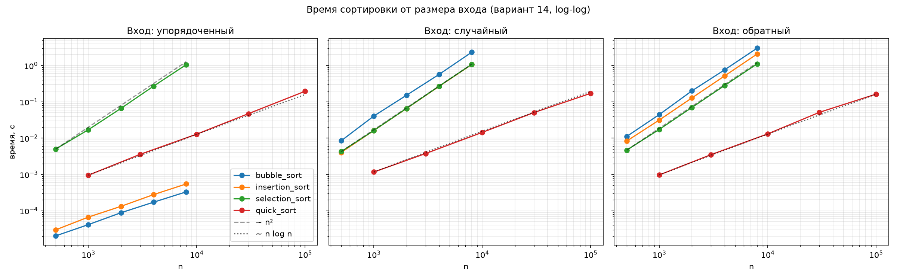

# Отчёт по ЛР 3. Базовые сортировки и быстрая сортировка

**Вариант:** N = `14`
**Seed:** `30 + 14 = 44`
**Окружение:** Python `3.11`, CPU `12th Gen Intel(R) Core(TM) i5-12400F — 6 ядер.`

## 1. Простые сортировки со счётчиками

Каждая функция сортирует **копию** входа (вход не меняется) и возвращает кортеж `(отсортированный список, число сравнений, число обменов/перемещений)`.

### 1.1. Сортировка пузырьком

```python
def bubble_sort(a: list) -> tuple[list, int, int]:
    """Сортировка пузырьком. Ожидаемая сложность: Θ(n²). В лучшем случае: Θ(n)."""
    comp = 0
    exch = 0
    a = a.copy()
    n = len(a)
    for i in range(n - 1):
        swapped = False
        for j in range(n - 1 - i):
            comp += 1
            if a[j] > a[j + 1]:
                a[j], a[j + 1] = a[j + 1], a[j]
                exch += 1
                swapped = True
        if not swapped:
            break
    return a, comp, exch
```

Сравниваются соседние элементы; за проход наибольший из оставшихся «всплывает» в конец, поэтому каждый следующий проход короче на один элемент. Если за проход не было ни одного обмена, массив уже упорядочен — досрочный выход (он и даёт лучший случай Θ(n)). Сравнение считается на каждую пару соседей, обмен — только реальный.

### 1.2. Сортировка вставками

```python
def insertion_sort(a: list) -> tuple[list, int, int]:
    """Сортировка вставками. Ожидаемая сложность: Θ(n²). В лучшем случае: Θ(n)."""
    comp = 0
    shft = 0
    a = a.copy()
    n = len(a)
    for i in range(1, n):
        x = a[i]
        j = i - 1
        while j >= 0:
            comp += 1
            if a[j] > x:
                a[j + 1] = a[j]
                shft += 1
                j -= 1
            else:
                break
        a[j + 1] = x
    return a, comp, shft
```

Элемент `x = a[i]` вставляется в упорядоченный префикс: бо́льшие элементы сдвигаются вправо, пока не найдётся `a[j] <= x` или не кончится префикс. Сравнением считается каждое вычисление `a[j] > x` (в том числе последнее, остановившее поиск); перемещением — один сдвиг. На упорядоченном входе каждый элемент сравнивается ровно один раз — Θ(n).

### 1.3. Сортировка выбором

```python
def selection_sort(a: list) -> tuple[list, int, int]:
    """Сортировка выбором. Ожидаемая сложность: Θ(n²) — в любом случае."""
    comp = 0
    exch = 0
    a = a.copy()
    n = len(a)
    for i in range(n - 1):
        m = i
        for j in range(i + 1, n):
            comp += 1
            if a[m] > a[j]:
                m = j
        if i != m:
            a[i], a[m] = a[m], a[i]
            exch += 1
    return a, comp, exch
```

На шаге `i` ищется минимум в `a[i..n-1]` и ставится на позицию `i`. Просмотр суффикса всегда полный, поэтому сравнений ровно `n(n-1)/2` на любом входе — отсюда Θ(n²) независимо от данных. Обмен считается только при `m != i`, поэтому обменов не более `n-1`.

### 1.4. Теоретические оценки

Пусть `inv` — число инверсий входа (от 0 до `n(n-1)/2`).

| Сортировка | Сравнения (лучший / худший) | Обмены/сдвиги | Время |
| --- | --- | --- | --- |
| Пузырёк | `n-1` / `n(n-1)/2` | ровно `inv` | Θ(n) лучший, Θ(n²) средний и худший |
| Вставки | `n-1` / `n(n-1)/2` | ровно `inv` | Θ(n) лучший, Θ(n²) средний и худший |
| Выбор | `n(n-1)/2` / `n(n-1)/2` | не более `n-1` | Θ(n²) всегда |

Обмен соседей в пузырьке и сдвиг во вставках убирают ровно одну инверсию, поэтому их число равно `inv`.

### 1.5. Проверка счётчиков на малых входах

Сравнения / обмены (сдвиги); значения получены ручным расчётом и совпадают с выводом программы.

| Вход | Пузырёк | Вставки | Выбор |
| --- | --- | --- | --- |
| `[1, 2, 3, 4, 5]` | 4 / 0 | 4 / 0 | 10 / 0 |
| `[5, 4, 3, 2, 1]` | 10 / 10 | 10 / 10 | 10 / 2 |
| `[2, 1, 2, 1]` | 6 / 3 | 5 / 3 | 6 / 2 |

На упорядоченном входе пузырёк и вставки делают `n-1` сравнений без обменов (лучший случай), выбор — по-прежнему `n(n-1)/2`. На обратном входе обмены пузырька и сдвиги вставок равны `n(n-1)/2 = inv`.

## 2. QuickSort с рандомизированным опорным элементом

```python
def quick_sort(a: list, rng: random.Random | None = None) -> list:
    """QuickSort с выбором опорного через rng.randrange и трёхсторонним разбиением.
    Ожидаемая сложность: в среднем Θ(n log n), в худшем случае Θ(n²)."""
    if rng is None:
        rng = random.Random()
    b = a.copy()

    def sort(lo, hi):
        if lo >= hi:  # 0 или 1 элемент
            return
        p = b[rng.randrange(lo, hi + 1)]  # опорное значение
        lt, i, gt = lo, lo, hi  # [lo, lt) < p, [lt, i) == p, (gt, hi] > p
        while i <= gt:
            if b[i] < p:
                b[lt], b[i] = b[i], b[lt]
                lt += 1
                i += 1
            elif b[i] > p:
                b[i], b[gt] = b[gt], b[i]
                gt -= 1
            else:
                i += 1
        sort(lo, lt - 1)
        sort(gt + 1, hi)

    sort(0, len(b) - 1)
    return b
```

### 2.1. Как это работает

- **Рандомизация.** Опорное значение `p` — элемент, выбранный равновероятно из всего отрезка `lo..hi` через `rng.randrange(lo, hi + 1)` (правая граница в `randrange` не включается, а `hi` — включительно, поэтому `+ 1`). Генератор `rng` передаётся снаружи, поэтому запуск воспроизводим по seed варианта.
- **Трёхстороннее разбиение.** Отрезок делится на три зоны: `[lo, lt)` — элементы меньше `p`, `[lt, i)` — равные `p`, `(gt, hi]` — больше `p`; `[i, gt]` — ещё не просмотренная часть. Элемент меньше `p` уходит в левую зону (обмен с `b[lt]`), больше `p` — в правую (обмен с `b[gt]`; `i` при этом не сдвигается, так как на его месте оказался непросмотренный элемент), равный `p` остаётся на месте.
- **Рекурсия.** `sort` рекурсивно обрабатывает только левую и правую зоны: элементы, равные опорному, уже стоят на своих местах. Базовый случай `lo >= hi` (0 или 1 элемент) — это и есть обработка малых подмассивов.
- **Копия входа.** Сортируется копия `b = a.copy()`, исходный список не меняется.

### 2.2. Сложность

| Случай | Что происходит | Оценка |
| --- | --- | --- |
| Средний | разбиения в среднем достаточно сбалансированы, глубина рекурсии порядка `log n`, на каждом уровне `Θ(n)` сравнений | Θ(n log n) |
| Худший | опорный на каждом шаге — минимум или максимум отрезка, одна из зон пуста: `T(n) = T(n-1) + Θ(n)` | Θ(n²) |

Память (стек рекурсии): в среднем `O(log n)`, в худшем `O(n)`.

### 2.3. Роль рандомизации

При детерминированном выборе (всегда первый или последний элемент) худший случай возникает на **конкретных входах** — упорядоченном и обратно упорядоченном: опорный каждый раз оказывается минимумом или максимумом, и разбиение вырождается. При случайном выборе время работы больше не зависит от порядка входа: плохой исход (опорный — экстремум отрезка) имеет вероятность около `2/n` на каждом шаге, а длинная цепочка таких исходов подряд маловероятна. Поэтому упорядоченный и обратный входы ведут себя так же, как случайный.

### 2.4. Почему разбиение трёхстороннее

Первая версия использовала схему Ломуто: опорный элемент ставился в `b[hi]`, а равные ему элементы уходили в правую часть. Верификация (раздел 6) показала, что на массиве из многих одинаковых элементов эта схема вырождается: разбиения получаются `(0, n-1)`, время становится Θ(n²), а глубина рекурсии доходит до `n` и превышает лимит Python (1000) — возникает `RecursionError`. Рандомизация здесь не помогает: все элементы равны, и любой выбор опорного даёт один и тот же результат. Трёхстороннее разбиение устраняет проблему: равные опорному элементы не попадают в рекурсию, и массив из одинаковых элементов обрабатывается за один проход.

## 3. Демонстрация стабильности

Сортировка **стабильна**, если элементы с равными ключами сохраняют в результате тот же относительный порядок, что и во входе. Для проверки используются пары «(ключ, метка)»: сортировка идёт только по ключу, а по порядку меток при равных ключах видно, стабильна ли она.

```python
from dataclasses import dataclass, field


@dataclass(order=True)
class Pair:
    """Пара (ключ, метка); сравнивается только по ключу."""

    key: int
    label: str = field(compare=False)  # метка в сравнении не участвует


def stability_demo() -> None:
    """Показать, какие из четырёх сортировок стабильны."""
    src = [Pair(2, "a"), Pair(1, "b"), Pair(2, "c"), Pair(1, "d")]
    algos = {
        "bubble_sort": lambda a: bubble_sort(a)[0],
        "insertion_sort": lambda a: insertion_sort(a)[0],
        "selection_sort": lambda a: selection_sort(a)[0],
        "quick_sort": lambda a: quick_sort(a, random.Random(0)),
    }
    print("\nСтабильность (порядок меток при равных ключах)")
    print("вход:", [(p.key, p.label) for p in src])
    for name, fn in algos.items():
        res = fn(src)
        # метки с ключом 1 и 2 должны остаться в исходном порядке: b,d и a,c
        ok1 = [p.label for p in res if p.key == 1] == ["b", "d"]
        ok2 = [p.label for p in res if p.key == 2] == ["a", "c"]
        verdict = "стабильна" if ok1 and ok2 else "НЕстабильна"
        print(f"  {name:<15}", [(p.key, p.label) for p in res], "->", verdict)
```

### 3.1. Как устроена проверка

- Обычные кортежи `(ключ, метка)` для этой цели не подходят: Python сравнивает их лексикографически, то есть при равных ключах сравнивает ещё и метки. Тогда равных элементов у сортировок просто нет, они упорядочивают пары по `(ключ, метка)`, и все четыре сортировки «оказываются стабильными» только потому, что метки идут по алфавиту. Пробный запуск на кортежах это подтвердил.
- Поэтому введён класс `Pair`: `@dataclass(order=True)` автоматически создаёт операторы сравнения, а `field(compare=False)` исключает метку из них. Сортировки видят только `key`, и сами четыре функции менять не пришлось.
- Во входе порядок меток при равных ключах: для ключа 1 — `b, d`, для ключа 2 — `a, c`. Сортировка стабильна, если после неё эти порядки сохранились.

### 3.2. Результат

| Сортировка | Результат | Порядок меток при ключе 1 / ключе 2 | Вывод |
| --- | --- | --- | --- |
| bubble_sort | (1,b) (1,d) (2,a) (2,c) | b, d / a, c | стабильна |
| insertion_sort | (1,b) (1,d) (2,a) (2,c) | b, d / a, c | стабильна |
| selection_sort | (1,b) (1,d) (2,c) (2,a) | b, d / **c, a** | **нестабильна** |
| quick_sort | (1,d) (1,b) (2,c) (2,a) | **d, b** / **c, a** | **нестабильна** |

### 3.3. Объяснение

- **Пузырёк и вставки стабильны.** Обмен (сдвиг) выполняется только при строгом `>`, поэтому элементы с равными ключами друг через друга не перемещаются.
- **Выбор нестабилен.** Он обменивает найденный минимум с элементом на позиции `i`, «перебрасывая» этот элемент через другие. В примере `(2, "a")` при обмене уходит в конец и оказывается позади `(2, "c")`.
- **QuickSort нестабилен.** Обмены при разбиении перебрасывают элементы на большие расстояния, не учитывая порядок равных ключей.

Стабильность важна, когда данные сортируются по нескольким ключам по очереди (например, сначала по имени, затем по возрасту: равные по возрасту должны остаться упорядоченными по имени), и когда порядок равных записей несёт смысл (время поступления, приоритет).

### 3.4. Замечание про QuickSort

У QuickSort нестабильность проявляется не на каждом запуске: порядок зависит от случайно выбранных опорных элементов, и на некоторых seed метки случайно остаются в исходном порядке. Один случай нарушения порядка доказывает нестабильность, а один случай без нарушения ничего не доказывает. В демонстрации поэтому зафиксирован генератор `Random(0)`, на котором нарушение наблюдается.

## 4. Замеры времени и log-log графики

**Методика.** Три класса входов (упорядоченный, случайный, обратный) генерируются `make_inputs` по seed = 44. Размеры: для простых сортировок n = 500…8000, для QuickSort n = 1000…100 000 (по 5 значений с геометрическим шагом). Для каждой точки: прогрев (не учитывается), 5 повторов, медиана; таймер `time.perf_counter()`. Замеры на одной машине (Python 3.11, Intel Core i5-12400F). Программа запускалась 7 раз; наклоны в запусках воспроизводятся (простые сортировки ≈ 2 на случайном и обратном входе, QuickSort 1,05–1,15), а график и таблицы ниже построены по последнему запуску.



Пунктир `~ n²` и точечная линия `~ n log n` нарисованы для сравнения наклонов.

**Наклоны** (МНК по всем точкам в log-log осях):

| Алгоритм | упорядоченный | случайный | обратный |
| --- | --- | --- | --- |
| bubble_sort | 1,01 | 2,00 | 2,03 |
| insertion_sort | 1,05 | 2,01 | 2,00 |
| selection_sort | 1,94 | 2,00 | 1,98 |
| quick_sort | 1,15 | 1,09 | 1,12 |

**Выводы.**

- **Упорядоченный вход.** Пузырёк и вставки имеют наклон ≈ 1 (Θ(n)): пузырёк делает один проход без обменов и досрочно выходит, вставки сравнивают каждый элемент с предыдущим один раз. Времена здесь порядка десятков микросекунд, поэтому разброс наклона между запусками больше (0,9–1,25). Выбор остаётся Θ(n²), так как всегда просматривает остаток массива.
- **Случайный и обратный вход.** Все три простые сортировки дают наклон ≈ 2 (Θ(n²)); различаются только константы: вставки быстрее пузырька (меньше сравнений), на обратном входе вставки вдвое медленнее, чем на случайном (вдвое больше сдвигов). Время выбора от входа не зависит.
- **QuickSort.** Наклон 1,09–1,15 соответствует n log n (у n log n наклон чуть больше 1: `1 + 1/ln n ≈ 1,11` при n ≈ 10⁴). На всех трёх классах время близко (≈ 0,16–0,20 с при n = 100 000): благодаря случайному опорному порядок входа не приводит к деградации до Θ(n²). Для сравнения, `selection_sort` на 100 000 элементов по экстраполяции заняла бы около 170 с.

## 5. Счётчики операций

Сравнения / обмены (сдвиги) на тех же входах, что и замеры.

**Пузырёк**

| n | упорядоченный | случайный | обратный |
| --- | --- | --- | --- |
| 500 | 499 / 0 | 124 614 / 62 201 | 124 750 / 124 750 |
| 1000 | 999 / 0 | 498 972 / 248 307 | 499 500 / 499 499 |
| 2000 | 1999 / 0 | 1 996 150 / 1 010 206 | 1 999 000 / 1 999 000 |
| 4000 | 3999 / 0 | 7 996 824 / 4 022 807 | 7 998 000 / 7 997 995 |
| 8000 | 7999 / 0 | 31 992 919 / 16 059 353 | 31 996 000 / 31 995 987 |

**Вставки**

| n | упорядоченный | случайный | обратный |
| --- | --- | --- | --- |
| 500 | 499 / 0 | 62 693 / 62 201 | 124 750 / 124 750 |
| 1000 | 999 / 0 | 249 300 / 248 307 | 499 500 / 499 499 |
| 2000 | 1999 / 0 | 1 012 198 / 1 010 206 | 1 999 000 / 1 999 000 |
| 4000 | 3999 / 0 | 4 026 793 / 4 022 807 | 7 998 000 / 7 997 995 |
| 8000 | 7999 / 0 | 16 067 343 / 16 059 353 | 31 996 000 / 31 995 987 |

**Выбор**

| n | упорядоченный | случайный | обратный |
| --- | --- | --- | --- |
| 500 | 124 750 / 0 | 124 750 / 497 | 124 750 / 250 |
| 1000 | 499 500 / 0 | 499 500 / 990 | 499 500 / 501 |
| 2000 | 1 999 000 / 0 | 1 999 000 / 1990 | 1 999 000 / 1000 |
| 4000 | 7 998 000 / 0 | 7 998 000 / 3989 | 7 998 000 / 2002 |
| 8000 | 31 996 000 / 0 | 31 996 000 / 7990 | 31 996 000 / 4007 |

Счётчики согласуются с теорией: на упорядоченном входе `n-1` сравнений и 0 обменов у пузырька и вставок, у выбора всегда `n(n-1)/2` сравнений; на обратном входе обменов (сдвигов) примерно `n(n-1)/2`, на случайном — примерно `n(n-1)/4`. Обмены пузырька и сдвиги вставок совпадают, так как оба равны числу инверсий. Небольшие отклонения на обратном входе (например, 499 499 вместо 499 500 при n = 1000) вызваны равными элементами в случайных данных варианта: равная пара не является инверсией.

## 6. Верификация

Верификация выполнена по методике `docs/ai-verification.md` (шаги 1–4). Часть кода писалась и проверялась с помощью ИИ-ассистента, поэтому результат каждого шага фиксируется ниже; все проверки собраны в функции `self_check`, которая запускается при каждом старте программы.

| Шаг | Что проверялось | Результат |
| --- | --- | --- |
| 1. Инварианты | выход упорядочен; выход — перестановка входа (`Counter`); входной список не изменён; счётчики: обмены пузырька и сдвиги вставок равны числу инверсий (эталон — полный перебор пар), у выбора ровно `n(n-1)/2` сравнений и не более `n-1` обменов, сравнения пузырька и вставок в допустимых границах | пройдено |
| 2. Тесты | пустой, один и два элемента; все равны; упорядоченный и обратный; отрицательные числа и дубликаты; точные значения счётчиков лучшего и худшего случаев при n = 1, 2, 10, 100; много одинаковых элементов (2000) | пройдено |
| 3. Эталон | сравнение с `sorted()` на 500 случайных входах (длина до 80, с дубликатами) для всех четырёх сортировок; QuickSort на 20 000 элементах | расхождений нет |
| 4. Сложность | аналитическая оценка — разделы 1 и 2; эмпирическая — наклоны в разделе 4 (≈ 2 и ≈ 1 у простых сортировок, ≈ 1,1 у QuickSort) | соответствует теории |

Стабильность отдельно проверена в разделе 3.

### 6.1. Найденный дефект

Тест на вырожденном входе выявил дефект первой версии QuickSort (схема Ломуто): на массиве из 2000 одинаковых элементов она завершалась с `RecursionError`. Причина описана в разделе 2.4: равные опорному элементы уходили в одну часть, разбиения получались `(0, n-1)`, глубина рекурсии доходила до `n`. На данных варианта (случайные числа в диапазоне `[-10⁶, 10⁶]`) дубликатов мало, поэтому замеры дефект не выявляли, и обнаружился он только проверкой вырожденных входов.

Исправление: разбиение заменено на трёхстороннее, в `self_check` добавлена проверка на 2000 одинаковых элементов (теперь проходит). Замеры и график перезапущены с итоговой версией, поэтому раздел 4 относится именно к ней.

Цена исправления — большая константа: на n = 100 000 время QuickSort выросло примерно с 0,12 с до 0,17 с (в 1,4 раза), так как трёхстороннее разбиение делает больше обменов. Асимптотика не изменилась.

### 6.2. Вывод о применимости

- Простые сортировки со счётчиками: **принять**.
- QuickSort, первая версия (схема Ломуто): **принять с доработкой** — корректен на данных варианта, но не работает на большом числе равных элементов.
- QuickSort, итоговая версия (трёхстороннее разбиение): **принять** — все проверки пройдены, дефект устранён.
