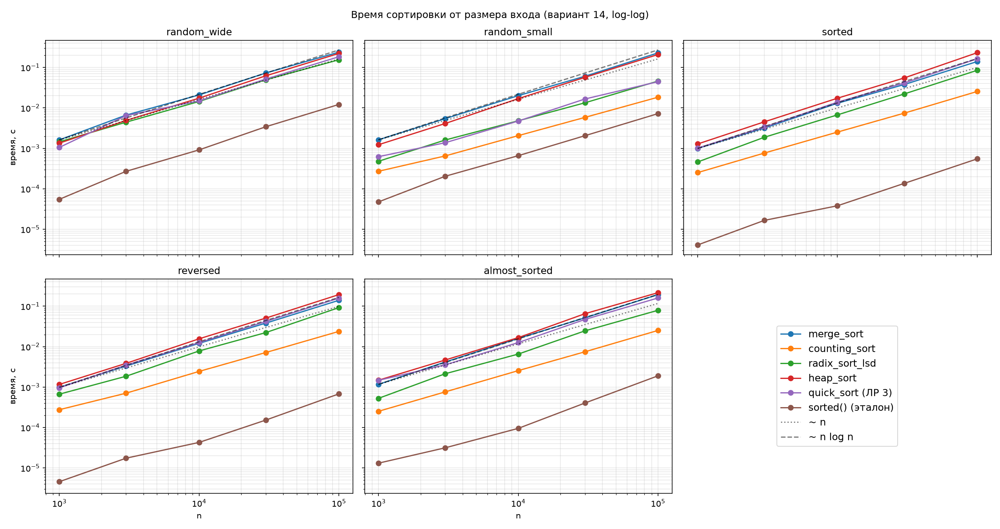

# Отчёт по ЛР 4. MergeSort, Counting, Radix и HeapSort: оценка производительности

**Вариант:** N = `14`
**Seed:** `30 + 14 = 44`
**Окружение:** Python `3.11`, CPU `12th Gen Intel(R) Core(TM) i5-12400F — 6 ядер.`

Код — в файле `lab-04-mergesort-linear-heapsort.py`, запуск: `python COMPLETED-LAB-04/lab-04-mergesort-linear-heapsort.py --variant 14`.
Код отформатирован `black` и проверен `pylint`.

## 1. MergeSort со стабильным слиянием

### 1.1. Реализация

```python
def merge(left: list, right: list, key) -> list:
    res = []
    i = j = 0
    while i < len(left) and j < len(right):
        if key(left[i]) <= key(right[j]):
            res.append(left[i])
            i += 1
        else:
            res.append(right[j])
            j += 1
    res.extend(left[i:])
    res.extend(right[j:])
    return res


def merge_sort(a: list, key=lambda x: x) -> list:
    if len(a) <= 1:
        return list(a)
    mid = len(a) // 2
    return merge(merge_sort(a[:mid], key), merge_sort(a[mid:], key), key)
```

Массив делится пополам, половины сортируются рекурсивно и сливаются двумя указателями: на каждом шаге в результат идёт меньший из `left[i]` и `right[j]`, остаток непустой половины добавляется целиком. `key` — функция ключа, как у `sorted()`. Вход не меняется: результат всегда новый список, даже в базовом случае (`list(a)` — копия).

- **Время:** `T(n) = 2·T(n/2) + Θ(n)` → **Θ(n log n) во всех случаях**: деление пополам не зависит от данных, на каждом из `log₂ n` уровней переносятся все `n` элементов. От входа зависит только число сравнений — на отсортированном входе ровно `(n/2)·log₂ n`, на случайном около `n·log₂ n` (счётчиком при `n = 1024`: 5 120 и 8 971).
- **Память:** Θ(n) дополнительно (результат слияния и срезы половин), стек рекурсии O(log n) — 17 уровней при `n = 10⁵`. Сортировка не in-place.

### 1.2. Тест стабильности

Стабильность даёт условие `<=` в `merge`: при равных ключах берётся элемент из левой половины, а она во входе целиком стоит раньше правой.

```python
def check_stability(sort_by_key) -> None:
    rng = random.Random(0)
    for _ in range(200):
        pairs = [(rng.randint(0, 5), i) for i in range(rng.randint(0, 100))]
        got = sort_by_key(pairs, lambda p: p[0])
        for prev, cur in zip(got, got[1:]):
            expect(
                prev[0] < cur[0] or (prev[0] == cur[0] and prev[1] < cur[1]),
                f"сортировка нестабильна: {prev} стоит перед {cur}",
            )
        expect(
            got == sorted(pairs, key=lambda p: p[0]),
            "сортировка нестабильна: при равных ключах нарушен порядок номеров",
        )
```

Пары `(ключ, номер)` сортируются только по ключу; ключи из `[0, 5]`, поэтому равных много. Проверяется, что у соседей номер растёт при равном ключе, и что результат совпадает со стабильным `sorted()`. Тест общий для сортировок с параметром `key` (используется и в разделе 2), входит в `self_check` и для `merge_sort` проходит.

Демонстрация (`merge_stability_demo`) на входе `[(2, 0), (1, 1), (2, 2), (0, 3), (1, 4), (2, 5), (0, 6), (1, 7)]` и эксперимент с `<` вместо `<=`:

| Ключ | Номера во входе | После `merge_sort` (`<=`) | При `<` |
| --- | --- | --- | --- |
| 0 | 3, 6 | 3, 6 | **6, 3** |
| 1 | 1, 4, 7 | 1, 4, 7 | **7, 4, 1** |
| 2 | 0, 2, 5 | 0, 2, 5 | **5, 2, 0** |

С `<` порядок равных полностью переворачивается, и тест падает (`(0, 45) стоит перед (0, 44)`), хотя обычная проверка на целых числах проходит — равные числа неотличимы. Поэтому стабильность проверяется именно на парах.

## 2. CountingSort

### 2.1. Реализация

```python
def counting_sort(a: list, key_max: int, key=lambda x: x) -> list:
    keys = [key(x) for x in a]
    if keys and (min(keys) < 0 or max(keys) > key_max):
        raise ValueError(f"ключи должны лежать в [0, {key_max}]")
    count = [0] * (key_max + 1)
    for k in keys:
        count[k] += 1
    for v in range(1, key_max + 1):
        count[v] += count[v - 1]
    res = [None] * len(a)
    for i in range(len(a) - 1, -1, -1):
        count[keys[i]] -= 1
        res[count[keys[i]]] = a[i]
    return res
```

Подсчитывается, сколько раз встречается каждый ключ. После префиксных сумм `count[v]` — число элементов с ключом `≤ v`, то есть конец блока ключа `v` в результате. Затем вход проходится **с конца**: элемент ставится в последнюю свободную ячейку своего блока, поэтому последний из равных оказывается в конце блока и порядок равных сохраняется. `key` нужен для теста на парах и для поразрядного прохода RadixSort (раздел 3). Ключи вне `[0, key_max]` дают `ValueError`: без проверки отрицательный ключ в Python молча попал бы в `count[-1]`.

- **Время:** Θ(n + k) во всех случаях — три прохода по входу (Θ(n)) и один по счётчикам (Θ(k)). Элементы не сравниваются, поэтому нижняя граница Ω(n log n) для сортировок сравнением здесь не действует.
- **Память:** Θ(n + k) — счётчики (`k`) плюс результат и список ключей (`n`). Для произвольных целых ключи сдвигаются на `min`, и тогда `k = max − min + 1`.

### 2.2. Диапазон ключей и устойчивость

`counting_range_experiment`: `n = 10 000` случайных ключей из `[0, k)`, медиана 5 запусков; пиковая память — `tracemalloc`.

| k | counting_sort, с | merge_sort, с | sorted(), с | пик памяти counting, МБ |
| --- | --- | --- | --- | --- |
| 10² | 0,0013 | 0,0198 | 0,0010 | 0,2 |
| 10³ | 0,0021 | 0,0195 | 0,0009 | 0,2 |
| 10⁴ | 0,0018 | 0,0190 | 0,0009 | 0,5 |
| 10⁵ | 0,0064 | 0,0184 | 0,0009 | 3,9 |
| 10⁶ | 0,0551 | 0,0185 | 0,0009 | 37,6 |
| 10⁷ | 0,5241 | 0,0188 | 0,0009 | 373,6 |

- Пока `k ≤ n`, время определяется `n`: counting в 10–15 раз быстрее `merge_sort`. При `k ≫ n` время и память растут линейно по `k` (×10 на каждый шаг), и уже при `k ≈ 30n` counting проигрывает `merge_sort`. Алгоритм имеет смысл, когда `k = O(n)`.
- Счётчик в Python стоит около 37 байт (8 байт ссылки + объект `int`). При `k = 10⁹` (распределение `random_wide`) это ~37 ГБ, поэтому в бенчмарке counting на этих данных пропускается.
- `sorted()` быстрее при любом `k`, потому что написан на C. Сравнивать асимптотику корректно с `merge_sort` — тоже чистый Python.

**Устойчивость.** `check_stability` для `counting_sort` проходит. Если расставлять элементы с **начала** массива при тех же префиксных суммах, порядок равных переворачивается (номера `6, 3` вместо `3, 6` и т. д.), и тест падает: `(0, 45) стоит перед (0, 44)`.

## 3. RadixSort LSD

### 3.1. Реализация

```python
def radix_sort_lsd(a: list[int], digit_sort=counting_sort) -> list[int]:
    if a and min(a) < 0:
        raise ValueError("radix_sort_lsd работает только с неотрицательными целыми")
    res = list(a)
    largest = max(a, default=0)
    exp = 1
    while largest // exp > 0:
        res = digit_sort(res, 9, key=lambda x, exp=exp: (x // exp) % 10)
        exp *= 10
    return res
```

Массив сортируется по цифрам от младшего разряда к старшему (`exp = 1, 10, 100, …`), пока не кончатся разряды максимума. Каждый проход — `counting_sort` из раздела 2 с ключом-цифрой `(x // exp) % 10`, то есть `k = 10`. Параметр `digit_sort` подменяется только в демонстрации (раздел 3.2). Работает с неотрицательными целыми.

- **Время:** Θ(d·(n + 10)) = Θ(d·n), где `d` — число цифр максимума. На 100 000 элементов: ключи до 100 (`d = 3`) — 0,054 с, до 10⁹ (`d = 10`) — 0,173 с.
- **Память:** Θ(n + 10) — от диапазона ключей не зависит, в отличие от CountingSort (Θ(n + k)). Поэтому RadixSort применим и к широкому диапазону, где counting пропускается (`k = 10⁹` → всего 10 проходов со счётчиками на 10 ячеек). Ограничение — ключи должны раскладываться на цифры (неотрицательные целые, строки фиксированной длины); при большом `d` растёт число проходов.

### 3.2. Почему поразрядный проход обязан быть устойчивым

После прохода по разряду `exp` массив упорядочен по младшим цифрам. Следующий проход упорядочивает по более старшей цифре, и у чисел с равной старшей цифрой порядок по младшим должен сохраниться — это и есть устойчивость. Неустойчивый проход его разрушает.

`radix_stability_demo` запускает `radix_sort_lsd` с устойчивым проходом и с `counting_sort_unstable` (расстановка с начала массива, равные переворачиваются) на входе `[53, 31, 12, 35, 14, 52]`:

| Проход | Устойчивый | Неустойчивый |
| --- | --- | --- |
| по единицам | `[31, 12, 52, 53, 14, 35]` | `[31, 52, 12, 53, 14, 35]` |
| по десяткам | `[12, 14, 31, 35, 52, 53]` — верно | `[14, 12, 35, 31, 53, 52]` — **неверно** |

На втором проходе `12` и `14` имеют равную цифру десятков: устойчивый проход оставляет их в порядке, полученном по единицам, неустойчивый переставляет. С неустойчивым проходом `radix_sort_lsd` дал неверный результат на всех 100 случайных массивах из 20 чисел.

Устойчивость самого прохода проверяет `check_digit_pass_stability` в `self_check`: для 100 случайных массивов и каждого разряда `counting_sort(a, 9, key=цифра)` совпадает со стабильным `sorted(a, key=цифра)`. Проверка и сверка `radix_sort_lsd` с `sorted()` проходят.

## 4. HeapSort

### 4.1. Реализация

```python
def sift_down(a: list[int], i: int, n: int) -> None:
    while True:
        largest = i
        left, right = 2 * i + 1, 2 * i + 2
        if left < n and a[left] > a[largest]:
            largest = left
        if right < n and a[right] > a[largest]:
            largest = right
        if largest == i:
            return
        a[i], a[largest] = a[largest], a[i]
        i = largest


def build_max_heap(a: list[int]) -> None:
    n = len(a)
    for i in range(n // 2 - 1, -1, -1):
        sift_down(a, i, n)


def heap_sort(a: list[int]) -> None:
    build_max_heap(a)
    for end in range(len(a) - 1, 0, -1):
        a[0], a[end] = a[end], a[0]
        sift_down(a, 0, end)
```

Массив рассматривается как двоичное дерево: потомки узла `i` — `2i + 1` и `2i + 2`. `sift_down` спускает элемент, меняя его с бо́льшим из потомков, пока он не станет не меньше обоих. `build_max_heap` просеивает узлы от последнего внутреннего (`n // 2 − 1`) к корню — листья уже являются кучами. В `heap_sort` максимум (корень) меняется с последним элементом кучи, куча сокращается на один, корень просеивается. Построение кучи выделено в отдельную функцию, чтобы проверять её результат (раздел 4.2).

- **Время:** построение кучи — **O(n)**: узлов на высоте `h` около `n / 2^(h+1)`, и сумма `Σ h · n / 2^(h+1)` ограничена `n`. Счётчик подтверждает: ~1,88 сравнения на элемент при `n = 10³, 10⁴, 10⁵`. Фаза извлечения — `n − 1` просеек от корня по O(log n), итого **Θ(n log n)** в среднем и худшем случае (около `1,8·n·log₂ n` сравнений при `n = 10⁵`). Лучший случай — все элементы равны: просейки останавливаются сразу, Θ(n).
- **Память:** **O(1)** — только обмены внутри `a`, без рекурсии и вспомогательного массива (in-place).

### 4.2. Проверка кучи и in-place; нестабильность

`check_heap` (входит в `self_check`) на 200 случайных массивах проверяет:
- после `build_max_heap` для каждого внутреннего узла `heap[i] ≥` обоих потомков, а куча — перестановка входа;
- `heap_sort` возвращает `None` и сортирует **тот же объект** списка (`id` не меняется) — сортировка на месте.

Обе проверки и общая сверка с `sorted()` проходят.

HeapSort **нестабилен**: обмен корня с последним элементом переносит элементы через всю кучу без учёта порядка равных. Уже на двух равных ключах `[(1, a), (1, b)]` первый обмен даёт `[(1, b), (1, a)]`; на `[(2, a), (1, b), (2, c), (1, d)]` результат `[(1, b), (1, d), (2, c), (2, a)]`.

## 5. Бенчмарк

### 5.1. Методика и результаты

Шесть сортировок (четыре из этой работы, QuickSort из ЛР 3 и встроенный `sorted()`) на пяти распределениях `make_datasets` по seed = 44: `random_wide` (ключи до 10⁹), `random_small` (ключи до 100), `sorted`, `reversed`, `almost_sorted` (~1 % случайных обменов). Размеры `n` = 10³, 3·10³, 10⁴, 3·10⁴, 10⁵. На каждую точку — прогрев и 5 повторов на свежей копии, медиана, `time.perf_counter()`. QuickSort получает `random.Random(seed)`, чтобы замеры были воспроизводимы. CountingSort на `random_wide` пропускается: счётчиков понадобилось бы 10⁹ (~37 ГБ, раздел 2.2). Программа запускалась 5 раз; наклоны ниже — разброс по всем запускам, таблица времени и график — последний запуск.



**Время при n = 10⁵, с**

| Алгоритм | random_wide | random_small | sorted | reversed | almost_sorted |
| --- | --- | --- | --- | --- | --- |
| merge_sort | 0,240 | 0,230 | 0,140 | 0,140 | 0,193 |
| counting_sort | — | 0,018 | 0,026 | 0,024 | 0,025 |
| radix_sort_lsd | 0,155 | 0,046 | 0,085 | 0,092 | 0,079 |
| heap_sort | 0,223 | 0,209 | 0,232 | 0,194 | 0,216 |
| quick_sort (ЛР 3) | 0,184 | 0,045 | 0,164 | 0,159 | 0,160 |
| sorted() | 0,0122 | 0,0072 | 0,0006 | 0,0007 | 0,0019 |

**Наклоны в log-log осях (МНК, разброс по 5 запускам)**

| Алгоритм | random_wide | random_small | sorted | reversed | almost_sorted |
| --- | --- | --- | --- | --- | --- |
| merge_sort | 1,06–1,11 | 1,04–1,11 | 1,00–1,09 | 1,06–1,10 | 1,09–1,15 |
| counting_sort | — | 0,89–1,01 | 0,92–1,00 | 0,94–1,04 | 0,94–1,05 |
| radix_sort_lsd | 0,96–1,02 | 0,95–1,00 | 1,03–1,12 | 1,07–1,12 | 1,08–1,17 |
| heap_sort | 1,10–1,13 | 1,05–1,14 | 1,10–1,12 | 1,11–1,16 | 1,08–1,20 |
| quick_sort (ЛР 3) | 1,07–1,10 | 0,96–0,97 | 1,08–1,11 | 1,10–1,14 | 1,04–1,10 |
| sorted() | 1,08–1,20 | 1,03–1,10 | 0,99–1,11 | 0,95–1,11 | 0,97–1,12 |

### 5.2. Сопоставление с асимптотикой

- **Θ(n log n)** — merge, heap, quick: наклоны 1,04–1,15. Для `n log n` на диапазоне 10³–10⁵ ожидается чуть больше 1 (`1 + 1/ln n ≈ 1,11` при `n = 10⁴`) — совпадает.
- **CountingSort** — наклон ≈ 1 (0,89–1,05), Θ(n + k): на `random_small` `k = 101` постоянно, на упорядоченных распределениях `k ≈ n`, в обоих случаях время линейно по `n`. Это самая быстрая из ручных сортировок — в 5–13 раз быстрее merge/heap.
- **RadixSort** — наклон ≈ 1, где число разрядов `d` постоянно (`random_wide`: `d = 10`, `random_small`: `d = 3`). На `sorted`/`reversed`/`almost_sorted` ключи — от 0 до `n`, и `d` растёт с `n` (3–4 разряда при 10³, 5–6 при 10⁵), поэтому наклон 1,03–1,17: Θ(d·n) с `d ~ log₁₀ n`. На `random_wide` 10 проходов всё равно быстрее сортировок сравнением.
- **QuickSort на `random_small`** в 3,5–4 раза быстрее, чем на остальных, с наклоном < 1: всего 101 различный ключ, а трёхстороннее разбиение не отправляет равные опорному в рекурсию, глубина ≈ log₂ 101.
- **MergeSort** на `sorted`/`reversed` быстрее (0,14 против 0,24 с): слияние упорядоченных половин делает вдвое меньше сравнений (раздел 1.1).
- **HeapSort** от порядка входа не зависит (≈ 0,2 с везде): построение кучи разрушает исходный порядок.
- **`sorted()`** (Timsort, C) на случайных данных в 15–30 раз быстрее ручных сортировок сравнением за счёт реализации на C, а на `sorted`/`reversed` — Θ(n): весь массив — одна упорядоченная серия, ~0,0006 с.
- Выброс: в первом запуске heap_sort на `almost_sorted` при `n = 10⁵` дал 0,37 с вместо ~0,21 (фоновая нагрузка), отсюда наклон 1,20; в остальных запусках 1,08–1,11.

## 6. Сводная таблица свойств

| Сортировка | Лучший | Средний | Худший | Доп. память | Стабильна | Ограничения применимости | Замер n = 10⁵, с |
| --- | --- | --- | --- | --- | --- | --- | --- |
| MergeSort | Θ(n log n) | Θ(n log n) | Θ(n log n) | Θ(n) | да | память Θ(n); не адаптивна (на упорядоченном входе — только меньше сравнений) | 0,14–0,24 |
| CountingSort | Θ(n + k) | Θ(n + k) | Θ(n + k) | Θ(n + k) | да | целые ключи из диапазона `k = max − min + 1`; имеет смысл при `k = O(n)`, при `k ≈ 30n` уже медленнее MergeSort, при `k = 10⁹` не помещается в память | 0,018–0,026 (`k ≤ n + 1`) |
| RadixSort LSD | Θ(d(n + b)) | Θ(d(n + b)) | Θ(d(n + b)) | Θ(n + b) | да | ключи, раскладываемые на `d` цифр (неотрицательные целые, строки фиксированной длины); внутренний проход обязан быть устойчивым; время растёт с `d` | 0,046 (`d = 3`) – 0,155 (`d = 10`) |
| HeapSort | Θ(n log n) | Θ(n log n) | Θ(n log n) | O(1), in-place | нет | не использует упорядоченность входа; при равных ключах нарушает порядок | 0,19–0,23 |
| QuickSort (ЛР 3) | Θ(n log n) | Θ(n log n) | Θ(n²), маловероятен при случайном опорном | стек O(log n), в худшем O(n) | нет | худший случай не исключён, только маловероятен; на многих дубликатах быстрее благодаря трёхстороннему разбиению | 0,045 (дубликаты) – 0,184 |
| `sorted()` (Timsort) | Θ(n) (упорядоченный или обратный вход) | Θ(n log n) | Θ(n log n) | O(n) | да | сортировка сравнением; реализация на C, поэтому быстрее всех ручных | 0,0006–0,0122 |

`n` — число элементов, `k` — размер диапазона ключей, `d` — число разрядов максимального ключа, `b` — основание системы счисления (у нас `b = 10`). Оценки лучшего случая — для различных ключей; в наших реализациях при всех равных ключах HeapSort (просейки сразу останавливаются, замер в разделе 4) и QuickSort (трёхстороннее разбиение за один проход, ЛР 3) работают за Θ(n).

**Выбор алгоритма:**
- небольшие целые ключи (`k = O(n)`) — CountingSort;
- широкий диапазон целых — RadixSort;
- нужна стабильность или гарантия n log n — MergeSort;
- ограничена память, нужен in-place с гарантией n log n — HeapSort;
- на практике в Python — встроенный `sorted()`.
